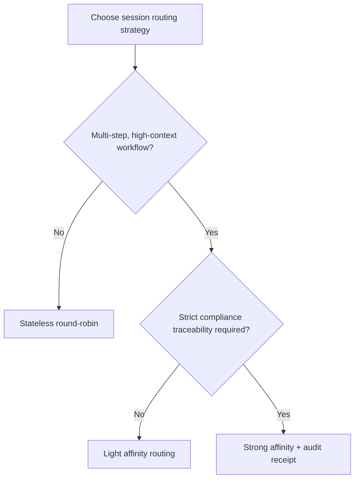
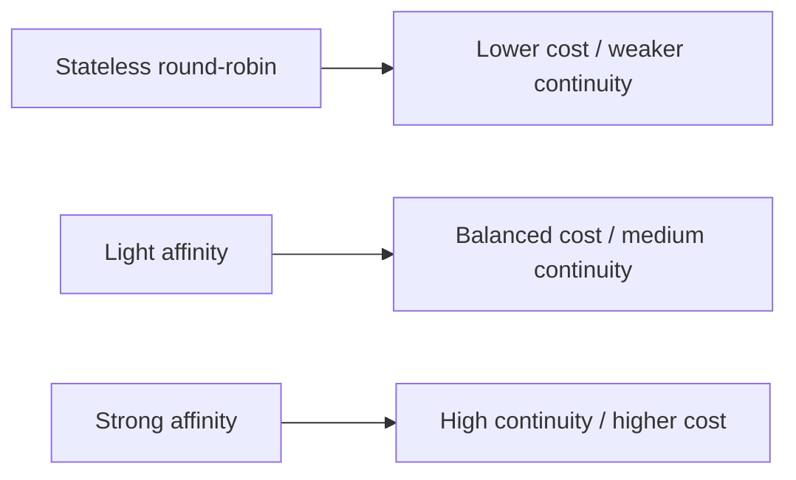
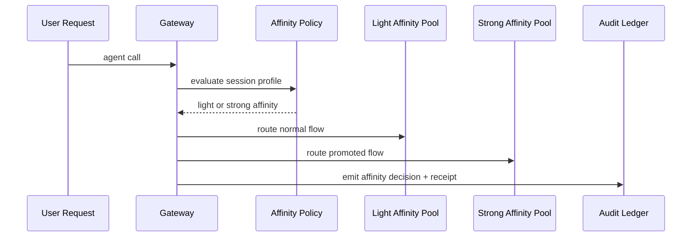

# Agent Session-Affinity Routing FAQ (Stateless Round-Robin vs Sticky Session Affinity)

> Scope lock: this topic covers only **session-affinity routing strategy** for agent runtime/gateway paths, not model selection or credential injection.

## 1) 📌 Core conclusions at a glance (3 points)

1. **Multi-step toolchains should default to session affinity** for higher execution continuity.  
2. **Stateless round-robin is still valid** for short, low-context requests and remains the lowest-cost option.  
3. **Production default should be tiered affinity**: light affinity for normal flow, strong affinity for critical or drift-prone flow, with budget fences.  

## 2) 🎯 Q1 / Q2 / Q3 (plain language + first principles)

### Q1: Why is pure stateless round-robin risky for many agent workflows?

- **Plain language**: each step can land on a different worker, so in-memory context, cache, and temp workspace continuity break.  
- **First principle**: multi-step reasoning depends on short-lived local state; frequent cross-instance migration raises recovery cost and failure probability.  

### Q2: When is stateless round-robin still the best choice?

- Short requests, small context, high retry tolerance;  
- Strong priority on minimal operational overhead and lowest per-session cost;  
- No strict requirement for session-level forensic replay.  

### Q3: How does tiered session-affinity governance work?

- **Plain language**: route normal flow with light affinity, then promote to strong affinity when drift risk is detected.  
- **First principle**: pay high continuity cost only for high-risk/high-value chains.  
- **Path**: request classification → light-affinity pool → drift trigger (error rate / instance-hop rate / SLO breach) → strong-affinity pool → audit receipt.  

## 3) 🧭 Mermaid views (TD decision tree + LR path + sequence)

## 4) 📊 Architect decision matrix

| Dimension | Stateless round-robin | Light affinity routing | Strong affinity routing (critical paths) |
|---|---|---|---|
| Unit cost | Low | Medium | High |
| Session continuity | Low | Medium | High |
| Failure-recovery complexity | Low | Medium | Medium-high |
| Compliance traceability | Medium | Medium-high | High |
| Default guidance | ✅ short requests | ✅ multi-tenant mainstream | ⚠ high-value/high-compliance paths |

## 5) 🧪 Quantitative example + 7-card insight

> Source of truth: `evidence/cycle-408-benchmark.json`.  
> Provenance labels: `measured` / `synthetic` / `anonymized_reported`; production paid-run metrics not executed are marked `not_measured`.

| Metric | Stateless baseline | Tiered session-affinity baseline |
|---|---:|---:|
| Workflow retry rate | 8.9% | 3.7% |
| P95 routing recovery latency | 226 ms | 179 ms |
| Budget-fence interception rate | 90.8% | 92.2% |
| Ops complexity score (1 low-10 high) | 4.3 | 6.1 |
| Production billing reconciliation | `not_measured` | `not_measured` |

7-card deck: `benchmark-cards.en.html` / `benchmark-cards.html` (4:5, CSP self-contained, coordinates from this cycle's sealed evidence only)

## 6) 🛠️ Production validation checklist

- [ ] Define light/strong affinity promotion conditions (error rate, instance-hop rate, SLO breach)
- [ ] Bind tenant-level session policy to budget fences
- [ ] Configure fallback path for strong-affinity lanes
- [ ] Persist affinity decisions into MCP/A2A audit ledger
- [ ] Run periodic cross-instance failover drills
- [ ] Verify continuity, latency, and cost metrics in one dashboard
- [ ] Publish evidence bundle (latency/throughput/policy/cost) for each release

