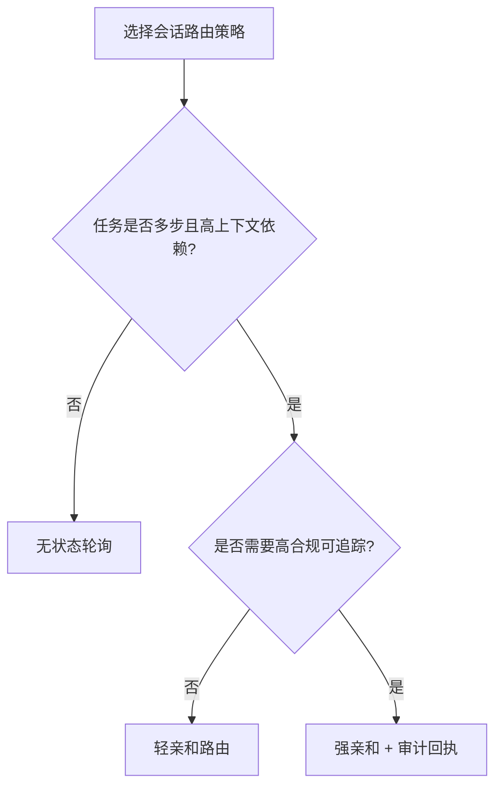
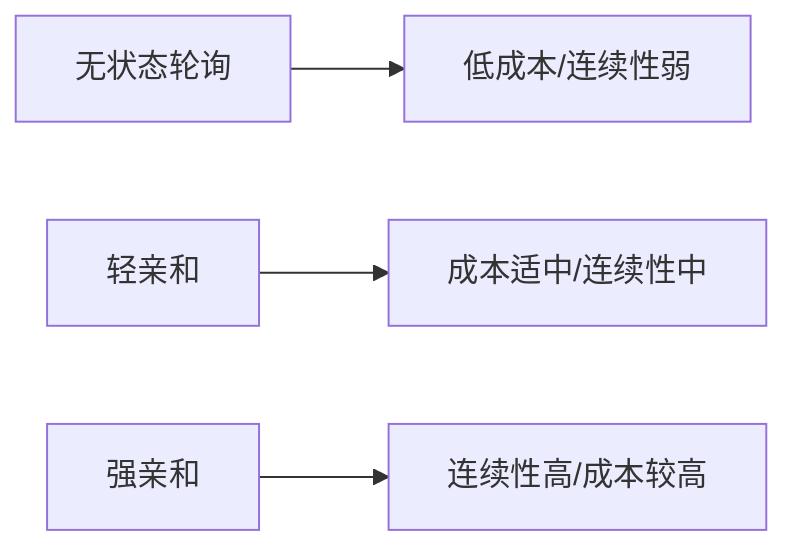
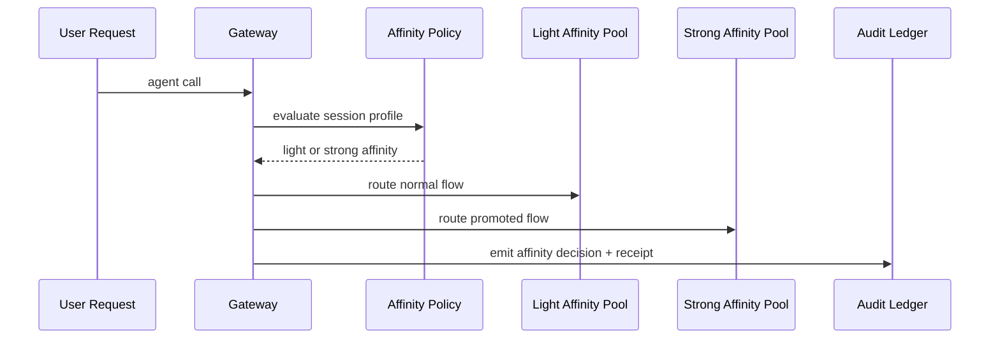

# Agent 会话亲和路由选型 FAQ（无状态轮询 vs 粘性会话亲和）

> 专题边界：仅讨论 Agent Runtime/Gateway 的 **会话亲和路由策略**，不扩展到模型选型或身份凭据注入主题。

## 1) 📌 核心结论速览（3 条）

1. **多步工具链默认要有会话亲和**：同一任务链路在同一执行上下文里完成，稳定性更高。  
2. **无状态轮询并非“过时”**：对短请求、低上下文依赖场景依旧是成本最低选项。  
3. **生产推荐分层亲和策略**：常态轻亲和、异常或关键流程升档强亲和，并挂预算围栏。  

## 2) 🎯 Q1 / Q2 / Q3（大白话 + 第一性原理）

### Q1：为什么很多 Agent 任务不能只做无状态轮询？

- **大白话**：如果每一步都被打到不同实例，工具缓存、会话内存和临时文件会“断层”。  
- **第一性原理**：多步推理链路依赖“短期局部状态”；频繁跨实例迁移会增加恢复成本和失败概率。  

### Q2：什么时候无状态轮询反而更优？

- 请求短、上下文小、重试容忍高；  
- 目标是极简运维和最低单位成本；  
- 不需要强一致会话轨迹或调试复盘。  

### Q3：核心机制 X（Tiered Session Affinity）怎么工作？

- **大白话**：普通请求先走轻亲和，检测到复杂链路或漂移风险时再升级强亲和。  
- **第一性原理**：把“连续性保障”按风险分层，只给高价值链路支付高亲和成本。  
- **链路**：请求分类 → 轻亲和池 → 漂移触发器（错误率/跳实例率/SLO）→ 强亲和池 → 审计回执。  

## 3) 🧭 Mermaid（决策树 TD + 路径 LR + 时序）

## 4) 📊 架构师决策矩阵

| 维度 | 无状态轮询 | 轻亲和路由 | 强亲和路由（关键链路） |
|---|---|---|---|
| 单位成本 | 低 | 中 | 高 |
| 会话连续性 | 低 | 中 | 高 |
| 故障恢复复杂度 | 低 | 中 | 中-高 |
| 合规可追踪性 | 中 | 中-高 | 高 |
| 默认建议 | ✅ 短请求 | ✅ 多租户主流 | ⚠ 高价值/高合规链路 |

## 5) 🧪 定量算例 + 7-Card 洞察

> 数据来源：`evidence/cycle-408-benchmark.json`。  
> 来源标签：`measured` / `synthetic` / `anonymized_reported`；生产真实付费实验未执行标 `not_measured`。

| 指标 | 无状态基线 | 分层会话亲和基线 |
|---|---:|---:|
| 任务链路重试率 | 8.9% | 3.7% |
| P95 路由恢复延迟 | 226 ms | 179 ms |
| 预算围栏拦截率 | 90.8% | 92.2% |
| 运营复杂度评分（1低-10高） | 4.3 | 6.1 |
| 生产账单对账 | `not_measured` | `not_measured` |

7-card：`benchmark-cards.html` / `benchmark-cards.en.html`（4:5 自包含、坐标仅取本轮封存证据）

## 6) 🛠️ 生产核验 Checklist

- [ ] 明确轻亲和/强亲和升级条件（错误率、跳实例率、SLO）
- [ ] 绑定租户级会话策略与预算围栏
- [ ] 为强亲和链路配置可回退路径
- [ ] 将亲和决策写入 MCP/A2A 审计账本
- [ ] 周期演练跨实例故障切换与恢复
- [ ] 验证路由连续性、延迟与成本指标同步可视化
- [ ] 发布时附证据包（latency/throughput/policy/cost）

