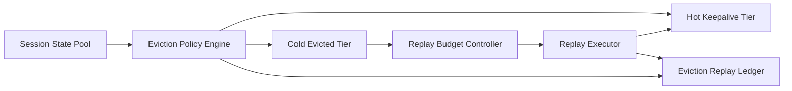

# Agent Session Eviction and Replay Budget Selection FAQ (Cycle 1827)

## 1) Three-minute decision
- **Core tension:** long sessions consume context/state capacity; no eviction causes saturation, but aggressive eviction hurts continuity.
- **Recommendation:** tiered session eviction + replay-budget gates + critical-session keepalive.
- **Goal:** measurable balance between capacity stability and user experience continuity.

## 2) Q1 / Q2 / Q3
### Q1: Why is idle-time eviction alone insufficient?
1) high-value sessions can be temporarily quiet but still critical,
2) low-value noisy sessions can cause state thrashing,
3) without replay budgets, recovery cost can explode.

### Q2: What production-ready strategy should be used?
- **Tiered eviction:** priority by business tier, activity, and risk tags,
- **Replay budget:** tenant caps on replay count, depth, and latency,
- **Critical keepalive:** hot snapshots and shortest recovery path for P0 sessions,
- **Observability:** eviction hit rate, replay success rate, recovery latency.

### Q3: How do we validate "lower resource usage without broken continuity"?
- state-pool utilization returns to target range,
- replay success and recovery latency meet goals,
- critical-session interruption rate remains low.

## 3) Reference architecture

## 4) Decision matrix
| Dimension | Unified timeout eviction | Tiered eviction plus budgeted replay (Recommended) |
|---|---:|---:|
| State-pool stability | Medium | High |
| Critical-session continuity | Low | High |
| Replay-cost controllability | Low | High |
| Implementation complexity | Low | Medium |
| Operational explainability | Medium | High |

## 5) Evidence and reproducibility
- Evidence files:
  - `workshops/azure-agent-infra/evidence/cycle-1827-benchmark.json`
  - `workshops/azure-agent-infra/evidence/cycle-1827-latency.csv`
  - `workshops/azure-agent-infra/evidence/cycle-1827-throughput.csv`
  - `workshops/azure-agent-infra/evidence/cycle-1827-policy.csv`
- Labels: `measured / synthetic / anonymized_reported`.
- validation7 enforces bilingual six-part structure, CSP self-contained 7-card output, strict cycle-evidence alignment, and replayability.

## 6) Production checklist
- [ ] Session tiers and eviction priorities are released.
- [ ] Replay budgets (count/depth/latency) are configured.
- [ ] Critical-session keepalive and fast-recovery path are validated.
- [ ] Eviction/replay alerts are integrated.
- [ ] FAQ/H5/SVG/7-card align with cycle evidence.
