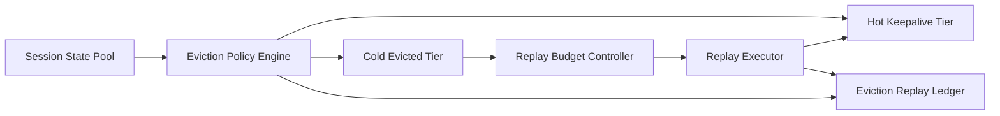

# Agent 会话驱逐与回放预算选型 FAQ（Cycle 1827）

## 1) 3 分钟结论
- **核心矛盾：** 长会话占用上下文和状态池，若不驱逐会拖垮容量；驱逐过度又会造成回放成本和体验断层。
- **推荐：** 分级会话驱逐策略 + 回放预算门禁 + 关键会话保活。
- **目标：** 在容量稳定与体验连续性之间建立可量化平衡。

## 2) Q1 / Q2 / Q3
### Q1：为什么仅按空闲时间驱逐不够？
1) 高价值会话可能短时静默但仍需保活；
2) 低价值会话频繁唤醒会放大状态抖动；
3) 无回放预算会导致恢复成本失控。

### Q2：生产可落地的驱逐与回放策略是什么？
- **分级驱逐**：按业务等级、会话活跃度、风险标签设置驱逐优先级；
- **回放预算**：每租户限定回放次数、回放深度和可接受时延；
- **关键保活**：对 P0 会话保留热状态快照与最短恢复路径；
- **观测联动**：实时跟踪驱逐命中率、回放成功率、恢复耗时。

### Q3：如何验证“省资源且不中断体验”？
- 状态池利用率回落到目标区间；
- 驱逐后回放成功率和恢复时延达标；
- 关键会话中断率保持低位。

## 3) 架构图

## 4) 选型矩阵
| 维度 | 统一超时驱逐 | 分级驱逐+预算回放（推荐） |
|---|---:|---:|
| 状态池稳定性 | 中 | 高 |
| 关键会话连续性 | 低 | 高 |
| 回放成本可控性 | 低 | 高 |
| 实施复杂度 | 低 | 中 |
| 运维可解释性 | 中 | 高 |

## 5) 证据与复算口径
- 证据文件：
  - `workshops/azure-agent-infra/evidence/cycle-1827-benchmark.json`
  - `workshops/azure-agent-infra/evidence/cycle-1827-latency.csv`
  - `workshops/azure-agent-infra/evidence/cycle-1827-throughput.csv`
  - `workshops/azure-agent-infra/evidence/cycle-1827-policy.csv`
- 标签：`measured / synthetic / anonymized_reported`。
- validation7：双语六段结构、7-card CSP 自包含、轮次与 evidence 一致、可回放链路通过。

## 6) 生产检查清单
- [ ] 会话分级与驱逐优先级规则已发布。
- [ ] 回放预算阈值（次数/深度/时延）已配置。
- [ ] 关键会话保活与最短恢复链路已验证。
- [ ] 驱逐与回放指标告警已联动。
- [ ] FAQ/H5/SVG/7-card 与 evidence 轮次一致。
