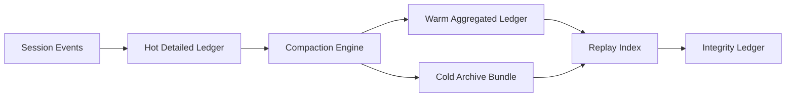

# Agent Session Ledger Compaction Selection FAQ (Cycle 1805)

## 1) Three-minute decision
- **Session-ledger bloat is usually caused by full-detail long retention, not per-write cost alone.**
- **Recommendation:** tiered compaction (hot detail, warm aggregation, cold archive) + integrity hash chains + replay indexes.
- **Goal:** reduce storage/query cost while preserving audit traceability and replay verifiability.

## 2) Core questions (Q1/Q2/Q3)
### Q1: Why is simple TTL deletion insufficient?
1) audit lineage breaks,
2) dispute events are hard to reconstruct,
3) compliance retention windows are unmet.

### Q2: What compaction strategy is practical?
- layer 1: keep short-window raw details in hot tier,
- layer 2: aggregate by session phases with integrity summaries,
- layer 3: archive compressed bundles with index pointers,
- guarantee: verify hash-chain continuity before and after compaction.

### Q3: How to validate effectiveness?
- material storage-cost reduction,
- no P95 query regression,
- target replay-consistency maintained on sample checks.

## 3) Reference architecture

## 4) Decision matrix
| Dimension | TTL-only deletion | Tiered compaction (Recommended) |
|---|---:|---:|
| Storage control | Medium | High |
| Audit traceability | Low | High |
| Replay verifiability | Low | High |
| Implementation complexity | Low | Medium |
| Query stability | Medium | High |

## 5) Evidence and reproducibility
- Evidence files:
  - `workshops/azure-agent-infra/evidence/cycle-1805-benchmark.json`
  - `workshops/azure-agent-infra/evidence/cycle-1805-latency.csv`
  - `workshops/azure-agent-infra/evidence/cycle-1805-throughput.csv`
  - `workshops/azure-agent-infra/evidence/cycle-1805-policy.csv`
- Labels: `measured / synthetic / anonymized_reported`.
- validation7 requires bilingual structure fidelity, CSP self-contained cards, cycle-consistent evidence, and replayability checks.

## 6) Production checklist
- [ ] Hot/warm/cold ledger tiering is enabled.
- [ ] Pre/post compaction hash-chain checks run automatically.
- [ ] Cold archive index supports fast session lookup.
- [ ] Sample replay jobs and alerts are integrated.
- [ ] FAQ/H5/SVG/7-card align with cycle evidence.
