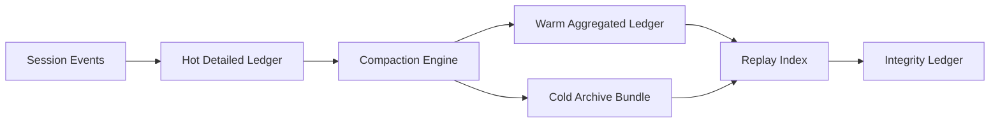

# Agent 会话账本压缩选型 FAQ（Cycle 1805）

## 1) 3 分钟结论
- **会话账本膨胀问题常见于“全量长期保留”，而非单次写入成本。**
- **推荐：** 分层压缩（热明细、温聚合、冷归档）+ 校验哈希链 + 可回放索引。
- **目标：** 降低存储和查询成本，同时保持审计可追溯与重放可验证。

## 2) 关键问题（Q1/Q2/Q3）
### Q1：为什么简单 TTL 删除不可取？
1) 审计链断裂；
2) 关键争议事件难复盘；
3) 合规留存窗口无法满足。

### Q2：可落地压缩策略？
- 一级：热层保留原始明细短窗口；
- 二级：温层按会话阶段聚合并保留校验摘要；
- 三级：冷层归档压缩包与索引指针；
- 保障：压缩前后哈希链一致性校验。

### Q3：如何验证策略有效？
- 存储成本显著下降；
- 查询 P95 不劣化；
- 抽样重放一致率保持目标区间。

## 3) 架构图

## 4) 选型矩阵
| 维度 | 仅 TTL 删除 | 分层压缩（推荐） |
|---|---:|---:|
| 存储可控性 | 中 | 高 |
| 审计可追溯性 | 低 | 高 |
| 重放可验证性 | 低 | 高 |
| 实施复杂度 | 低 | 中 |
| 查询稳定性 | 中 | 高 |

## 5) 证据与复算口径
- 证据文件：
  - `workshops/azure-agent-infra/evidence/cycle-1805-benchmark.json`
  - `workshops/azure-agent-infra/evidence/cycle-1805-latency.csv`
  - `workshops/azure-agent-infra/evidence/cycle-1805-throughput.csv`
  - `workshops/azure-agent-infra/evidence/cycle-1805-policy.csv`
- 标签：`measured / synthetic / anonymized_reported`。
- validation7：双语结构、CSP 自包含、证据轮次一致、可回放链路校验通过。

## 6) 生产检查清单
- [ ] 热/温/冷账本分层策略已启用。
- [ ] 压缩前后哈希链校验自动执行。
- [ ] 冷归档索引支持按会话快速定位。
- [ ] 抽样重放任务与告警已接入。
- [ ] FAQ/H5/SVG/7-card 与 evidence 轮次一致。
