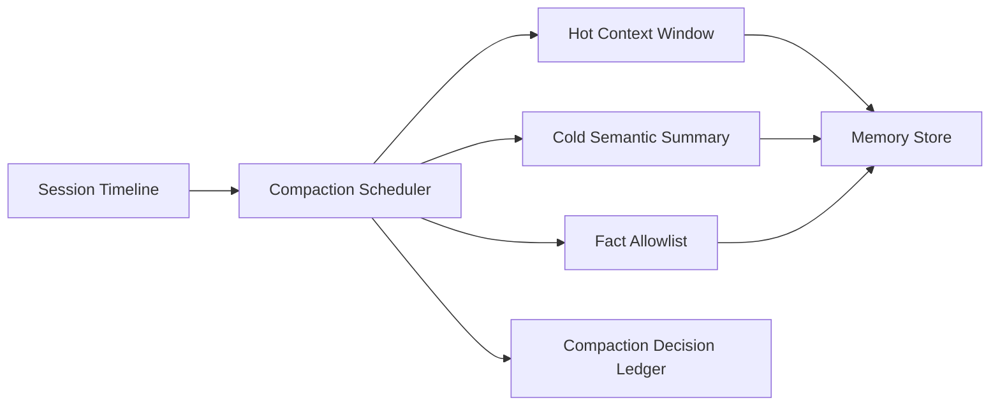

# Agent Session Memory Compaction Policy Selection FAQ (Cycle 1782)

## 1) Three-minute decision
- **For long-running agents, stability bottlenecks usually come from session-memory growth, not single-inference latency.**
- **Recommendation:** tiered memory (hot context + cold summaries) with periodic compaction and fact allowlists.
- **Goal:** control memory growth while preserving critical semantics.

## 2) Core questions (Q1/Q2/Q3)
### Q1: Why is naive truncation unsafe?
1) critical facts can be dropped,
2) later decisions drift without context,
3) multi-step task continuity degrades.

### Q2: What is the minimum viable compaction set?
- hot context for recent decisions/open actions,
- cold semantic summaries for historical dialogue,
- fact allowlist for IDs, thresholds, and hard constraints.

### Q3: How to validate post-compaction quality?
- answer consistency stays above threshold,
- task success rate remains stable,
- memory-growth slope meaningfully decreases.

## 3) Reference architecture

## 4) Decision matrix
| Dimension | Hard truncation | Tiered compaction + fact retention (Recommended) |
|---|---:|---:|
| Semantic integrity | Low | High |
| Memory controllability | Medium | High |
| Task continuity | Low | High |
| Implementation complexity | Low | Medium |
| Auditability | Medium | High |

## 5) Evidence and reproducibility
- Evidence files:
  - `workshops/azure-agent-infra/evidence/cycle-1782-benchmark.json`
  - `workshops/azure-agent-infra/evidence/cycle-1782-latency.csv`
  - `workshops/azure-agent-infra/evidence/cycle-1782-throughput.csv`
  - `workshops/azure-agent-infra/evidence/cycle-1782-policy.csv`
- Labels: `measured / synthetic / anonymized_reported`.
- validation7 requires bilingual structure, CSP self-contained cards, evidence consistency, and replayability trace.

## 6) Production checklist
- [ ] Hot-context windows are tunable and canaried.
- [ ] Cold-summary compression has quality thresholds.
- [ ] Fact-allowlist rules are auditable.
- [ ] Compaction/recovery events are ledgered.
- [ ] FAQ/H5/SVG/7-card references are cycle-aligned.
