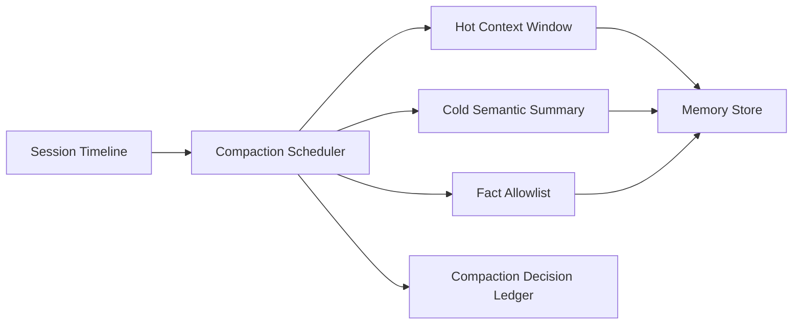

# Agent Session 内存压缩策略选型 FAQ（Cycle 1782）

## 1) 3 分钟结论
- **长会话 Agent 的稳定性瓶颈通常是会话内存膨胀，而非单次推理耗时。**
- **推荐：** 分层记忆（热上下文/冷摘要）+ 周期性压缩 + 关键事实白名单保留。
- **目标：** 在不丢失关键语义的前提下控制会话内存增长与恢复时延。

## 2) 关键问题（Q1/Q2/Q3）
### Q1：为什么简单截断历史会话不可取？
1) 关键事实可能被误删；
2) 后续决策缺少上下文导致漂移；
3) 多轮任务链完整性被破坏。

### Q2：可落地压缩策略最小集合是什么？
- 热上下文：近期决策与未完成动作保留；
- 冷摘要：历史对话按语义块压缩；
- 事实白名单：ID、策略阈值、用户约束强保留。

### Q3：如何验证压缩后质量可接受？
- 回答一致性评分维持阈值；
- 任务成功率无显著下降；
- 内存占用增长率明显收敛。

## 3) 架构图

## 4) 选型矩阵
| 维度 | 直接截断 | 分层压缩+事实保留（推荐） |
|---|---:|---:|
| 语义完整性 | 低 | 高 |
| 内存可控性 | 中 | 高 |
| 任务连续性 | 低 | 高 |
| 实施复杂度 | 低 | 中 |
| 可审计性 | 中 | 高 |

## 5) 证据与复算口径
- 证据文件：
  - `workshops/azure-agent-infra/evidence/cycle-1782-benchmark.json`
  - `workshops/azure-agent-infra/evidence/cycle-1782-latency.csv`
  - `workshops/azure-agent-infra/evidence/cycle-1782-throughput.csv`
  - `workshops/azure-agent-infra/evidence/cycle-1782-policy.csv`
- 标签：`measured / synthetic / anonymized_reported`。
- validation7：双语结构、CSP、证据一致、可回放链路全部通过。

## 6) 生产检查清单
- [ ] 热上下文窗口可配置且可灰度。
- [ ] 冷摘要压缩有质量监控阈值。
- [ ] 事实白名单规则可审计。
- [ ] 压缩决策与恢复事件进入账本。
- [ ] FAQ/H5/SVG/7-card 与 evidence 轮次一致。
