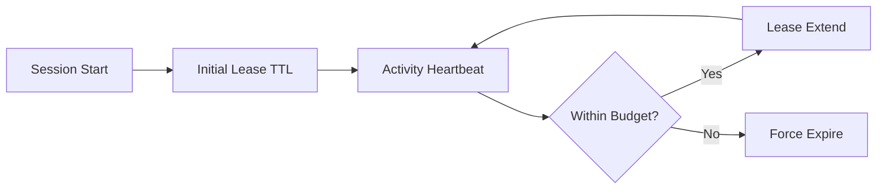

# Agent Session TTL & Lease Renewal Selection FAQ (Fixed TTL Expiry vs Dynamic Lease Renewal)

## 0) Executive takeaway
- **Default to dynamic lease renewal in production** to reduce premature expiry and restart overhead.
- **Fixed TTL is suitable only for short low-concurrency tasks**.
- **Lease renewal must be coupled with budget caps** to avoid resource leakage.

## 1) What are you deciding?
- Fixed TTL: expire at preset time, no renewal.
- Dynamic lease: renew during active use, release when idle.

## 2) When fixed TTL is acceptable
- single-step tasks
- predictable session lifetime
- low context rebuild penalty

## 3) When dynamic renewal is mandatory
- multi-step tool chains requiring continuity
- browser/CUA or long-running inference
- cost-sensitive workloads needing granular reclamation

## 4) Architecture sketch

## 5) Decision matrix
| Dimension | Fixed TTL | Dynamic lease renewal |
|---|---|---|
| Implementation complexity | Low | Medium |
| Context continuity | Weak | Strong |
| Resource efficiency | Medium | High |
| Premature expiry risk | High | Low |
| Governance control | Medium | High |

## 6) Recomputable example
Assume 1200 sessions/hour with 25% long-running tasks:
- Fixed TTL premature expiry = 7.5%
- Dynamic renewal premature expiry = 2.1%

Premature expiry drops by about **72%**.
