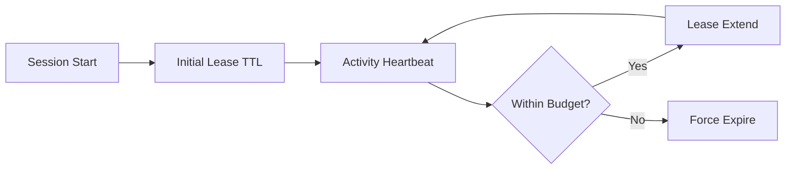

# Agent 会话TTL与租约续期选型 FAQ（固定TTL过期 vs 动态租约续期）

## 0) 一句话结论
- **生产默认选动态租约续期**，可在高并发下减少“误过期”与重复启动成本。
- **固定TTL只适合短任务、低并发场景**，长链路下易触发上下文丢失。
- **租约续期必须与预算上限联动**，防止“永不释放”导致资源泄漏。

## 1) 你在选什么
- 固定TTL：创建时设定失效时间，不续租。
- 动态租约：活动期间按策略续期，空闲后释放。

## 2) 固定TTL适用
- 单步任务
- 会话生命周期可预测
- 对重建上下文不敏感

## 3) 动态租约必选
- 多步工具链、需要上下文连续性
- 浏览器/CUA 或长时推理任务
- 资源成本敏感且需要精细回收

## 4) Mermaid

## 5) 决策矩阵
| 维度 | 固定TTL | 动态租约续期 |
|---|---|---|
| 实现复杂度 | 低 | 中 |
| 上下文连续性 | 弱 | 强 |
| 资源利用率 | 中 | 高 |
| 误过期风险 | 高 | 低 |
| 治理可控性 | 中 | 高 |

## 6) 可复算算例
假设每小时 1200 会话，长任务占 25%：
- 固定TTL：误过期率 7.5%
- 动态续期：误过期率 2.1%

误过期率下降约 **72%**。
