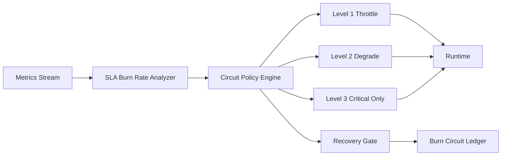

# Agent SLA Burn Rate Circuit Policy Selection FAQ (Cycle 1833)

## 1) Three-minute decision
- **Core tension:** instant error-rate triggers miss sustained degradation, and by the time full circuit break happens the SLA budget is often already over-burned.
- **Recommendation:** burn-rate-driven multi-level circuit policy with gated recovery.
- **Goal:** intervene early when SLA is consumed too quickly, containing blast radius while preserving critical service.

## 2) Q1 / Q2 / Q3
### Q1: Why are fixed-threshold circuits insufficient?
1) peak noise can cause false trips,
2) long mild degradation can be ignored,
3) tenant workloads have different SLA sensitivities.

### Q2: What production-ready burn-rate circuit strategy should be used?
- **Burn windows:** compute SLA consumption over 5-minute and 30-minute windows,
- **Multi-level circuits:** throttle first, degrade second, critical-only third,
- **Recovery gate:** staged restore only after burn rate returns to safe bands,
- **Tenant differentiation:** stricter thresholds and faster alerts for critical tenants.

### Q3: How do we validate early mitigation without over-blocking?
- earlier intervention lead time before major incidents,
- lower false-trigger circuit rate,
- higher SLA attainment on critical paths.

## 3) Reference architecture

## 4) Decision matrix
| Dimension | Fixed-threshold circuit | Burn-rate circuit (Recommended) |
|---|---:|---:|
| Early mitigation capability | Low | High |
| False-trigger control | Medium | High |
| Multi-tenant fit | Low | High |
| Implementation complexity | Low | Medium |
| Operational explainability | Medium | High |

## 5) Evidence and reproducibility
- Evidence files:
  - `workshops/azure-agent-infra/evidence/cycle-1833-benchmark.json`
  - `workshops/azure-agent-infra/evidence/cycle-1833-latency.csv`
  - `workshops/azure-agent-infra/evidence/cycle-1833-throughput.csv`
  - `workshops/azure-agent-infra/evidence/cycle-1833-policy.csv`
- Labels: `measured / synthetic / anonymized_reported`.
- validation7 enforces bilingual six-part structure, CSP self-contained 7-card output, strict cycle-evidence alignment, and replayability.

## 6) Production checklist
- [ ] Multi-window burn-rate thresholds are configured and versioned.
- [ ] Multi-level circuit and recovery gates are integrated.
- [ ] Critical-tenant differentiated thresholds and alerts are validated.
- [ ] Circuit ledger is traceable and replay-ready.
- [ ] FAQ/H5/SVG/7-card align with cycle evidence.
