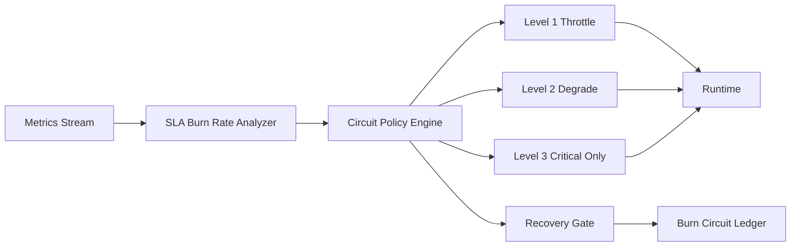

# Agent SLA 燃尽率熔断策略选型 FAQ（Cycle 1833）

## 1) 3 分钟结论
- **核心矛盾：** 仅看瞬时错误率会漏掉持续劣化，等到全面熔断时往往已超出 SLA 预算。
- **推荐：** 燃尽率驱动的多级熔断策略 + 分层恢复门禁。
- **目标：** 在 SLA 被消耗过快时提前干预，避免故障扩散并保留核心服务能力。

## 2) Q1 / Q2 / Q3
### Q1：为什么固定阈值熔断不够？
1) 高峰期短时波动可能误触发；
2) 长时间轻微错误会被忽略；
3) 多租户下不同任务对 SLA 敏感度不同。

### Q2：可落地的燃尽率熔断策略是什么？
- **燃尽率窗口**：同时计算 5 分钟和 30 分钟窗口的 SLA 消耗速率；
- **多级熔断**：先限流，再降级，最后仅保留关键路径；
- **恢复门禁**：燃尽率回到安全带并持续稳定后分级恢复；
- **租户差异化**：关键租户采用更严格门限和更快告警。

### Q3：如何验证“提前止损且避免误杀”？
- 重大故障发生前的干预提前量提升；
- 误触发熔断率下降；
- 关键链路 SLA 达标率提升。

## 3) 架构图

## 4) 选型矩阵
| 维度 | 固定阈值熔断 | 燃尽率熔断（推荐） |
|---|---:|---:|
| 提前止损能力 | 低 | 高 |
| 误触发控制 | 中 | 高 |
| 多租户适配 | 低 | 高 |
| 实施复杂度 | 低 | 中 |
| 运营可解释性 | 中 | 高 |

## 5) 证据与复算口径
- 证据文件：
  - `workshops/azure-agent-infra/evidence/cycle-1833-benchmark.json`
  - `workshops/azure-agent-infra/evidence/cycle-1833-latency.csv`
  - `workshops/azure-agent-infra/evidence/cycle-1833-throughput.csv`
  - `workshops/azure-agent-infra/evidence/cycle-1833-policy.csv`
- 标签：`measured / synthetic / anonymized_reported`。
- validation7：双语六段结构、7-card CSP 自包含、轮次与 evidence 一致、可回放链路通过。

## 6) 生产检查清单
- [ ] 燃尽率多窗口阈值已配置并版本化。
- [ ] 多级熔断与恢复门禁已联调。
- [ ] 关键租户差异化门限与告警已验证。
- [ ] 熔断账本可追溯并支持回放。
- [ ] FAQ/H5/SVG/7-card 与 evidence 轮次一致。
