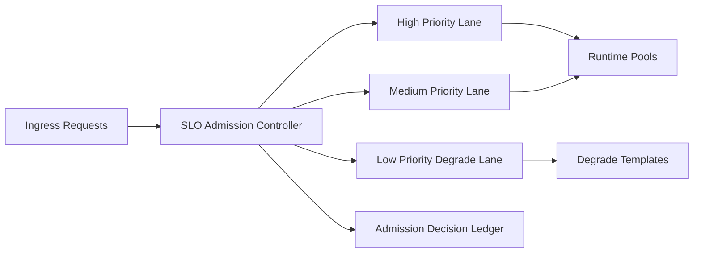

# Agent SLO Admission Controller Selection FAQ (Cycle 1804)

## 1) Three-minute decision
- **Service meltdowns are often triggered by unbounded admission queues, not model failure alone.**
- **Recommendation:** SLO-aware admission control + priority budget quotas + overload degradation paths.
- **Goal:** protect critical lanes first during bursts/incidents and prevent global latency collapse.

## 2) Core questions (Q1/Q2/Q3)
### Q1: Why is backend auto-scaling alone insufficient?
1) scaling reacts with delay,
2) burst spikes can saturate queues before scale-out,
3) low-priority traffic can consume high-priority capacity.

### Q2: What admission strategy is practical?
- layer 1: define SLO tiers by tenant/business class,
- layer 2: enforce token budgets and concurrency limits at ingress,
- layer 3: route low-priority requests to degrade templates under overload,
- audit: ledger every deny/degrade decision.

### Q3: How to validate effectiveness?
- improved SLO attainment for high-priority traffic,
- reduced volatility of overall P95/P99 latency,
- controlled and explainable deny/degrade rates.

## 3) Reference architecture

## 4) Decision matrix
| Dimension | No admission gate | SLO admission control (Recommended) |
|---|---:|---:|
| Priority protection | Low | High |
| Overload stability | Low | High |
| Latency controllability | Medium | High |
| Implementation complexity | Low | Medium |
| Auditability | Medium | High |

## 5) Evidence and reproducibility
- Evidence files:
  - `workshops/azure-agent-infra/evidence/cycle-1804-benchmark.json`
  - `workshops/azure-agent-infra/evidence/cycle-1804-latency.csv`
  - `workshops/azure-agent-infra/evidence/cycle-1804-throughput.csv`
  - `workshops/azure-agent-infra/evidence/cycle-1804-policy.csv`
- Labels: `measured / synthetic / anonymized_reported`.
- validation7 requires bilingual structure fidelity, CSP self-contained cards, cycle-consistent evidence, and replayability checks.

## 6) Production checklist
- [ ] SLO tiers and tenant mappings are active.
- [ ] Ingress token/concurrency limits are tunable.
- [ ] Low-priority degrade templates trigger under overload.
- [ ] Admission deny/degrade events are auditable and rollback-safe.
- [ ] FAQ/H5/SVG/7-card align with cycle evidence.
