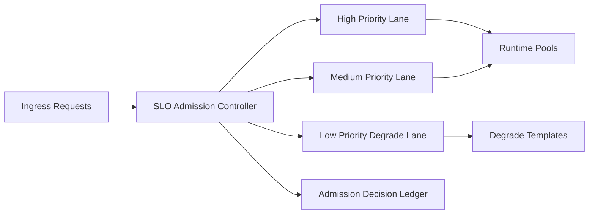

# Agent SLO 准入控制器选型 FAQ（Cycle 1804）

## 1) 3 分钟结论
- **服务雪崩常由“无限排队接入”触发，而非单点模型故障本身。**
- **推荐：** SLO 感知准入控制 + 优先级预算配额 + 过载降级路径。
- **目标：** 在高峰或异常时先保关键路径，避免全局延迟失控和错误放大。

## 2) 关键问题（Q1/Q2/Q3）
### Q1：为什么仅靠后端扩容不够？
1) 扩容生效存在滞后；
2) 流量突刺会先击穿排队系统；
3) 低优请求可能挤占高优容量。

### Q2：可落地准入策略是什么？
- 一级：按租户与业务等级定义 SLO 档位；
- 二级：入口按档位执行令牌预算与并发门限；
- 三级：触发过载时对低优请求走降级模板；
- 审计：每次拒绝/降级决策写入账本。

### Q3：如何验证策略有效？
- 高优流量 SLO 达标率提升；
- 总体 P95/P99 延迟波动下降；
- 拒绝率与降级率受控并可解释。

## 3) 架构图

## 4) 选型矩阵
| 维度 | 无准入门控 | SLO 准入控制（推荐） |
|---|---:|---:|
| 高优保障能力 | 低 | 高 |
| 过载稳定性 | 低 | 高 |
| 延迟可控性 | 中 | 高 |
| 实施复杂度 | 低 | 中 |
| 可审计性 | 中 | 高 |

## 5) 证据与复算口径
- 证据文件：
  - `workshops/azure-agent-infra/evidence/cycle-1804-benchmark.json`
  - `workshops/azure-agent-infra/evidence/cycle-1804-latency.csv`
  - `workshops/azure-agent-infra/evidence/cycle-1804-throughput.csv`
  - `workshops/azure-agent-infra/evidence/cycle-1804-policy.csv`
- 标签：`measured / synthetic / anonymized_reported`。
- validation7：双语结构、CSP 自包含、证据轮次一致、可回放链路校验通过。

## 6) 生产检查清单
- [ ] SLO 档位与租户映射规则已上线。
- [ ] 入口令牌预算与并发门限可动态调整。
- [ ] 低优降级模板在过载场景可触发。
- [ ] 准入拒绝与降级事件可审计可回滚。
- [ ] FAQ/H5/SVG/7-card 与 evidence 轮次一致。
