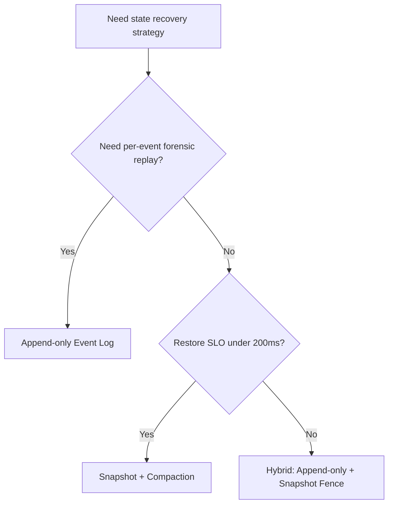
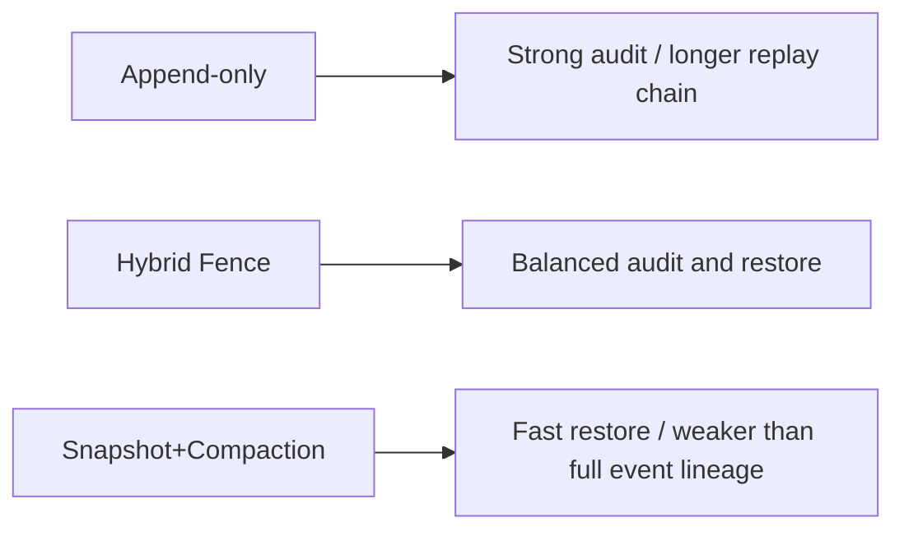
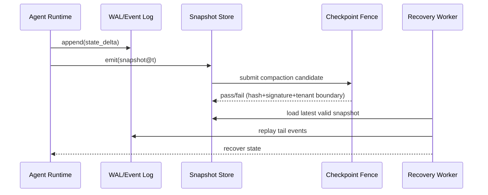

# Agent State Checkpoint Strategy FAQ (Append-only Event Log vs Snapshot + Compaction)

> Scope boundary: this FAQ focuses only on **Agent state checkpoint strategy**. It does not expand into identity injection, model routing, or supply-chain topics.

## 1) 📌 Executive summary (3 takeaways)

1. **Default production pattern: append-only event log + periodic snapshots + controlled compaction** to balance traceability, restore latency, and storage cost.  
2. **Pure append-only is strongest for audit-heavy workloads**, but replay depth grows over time and increases read amplification.  
3. **Pure snapshot+compaction minimizes restore time**, but without replay lineage and integrity fences, forensic confidence drops.

## 2) 🎯 Q1 / Q2 / Q3 (plain words + first principles)

### Q1: What is an append-only event log, and when should it be preferred?

- **Plain words**: every state transition is appended like a ledger entry; nothing is overwritten in place.  
- **First principle**: state can be reconstructed from changes; reconstructability enables verification, and verification enables auditability.  
- **Best fit**: financial zero-trust, compliance evidence retention, and incident forensics.

### Q2: What is snapshot + compaction, and when should it be preferred?

- **Plain words**: take periodic state snapshots, then compress/archive older logs so recovery does not replay the full history.  
- **First principle**: recovery cost is proportional to replay length; truncating replay after a valid snapshot stabilizes restore SLO.  
- **Best fit**: high-concurrency SaaS Agent platforms with strict recovery latency targets.

### Q3: What is the key technique (Checkpoint Fence), and how does it work?

- **Plain words**: a Checkpoint Fence blocks any snapshot/compaction artifact from production reads until integrity checks pass.  
- **First principle**: faster recovery is never allowed to violate verifiability; verify first, then admit.  
- **Mechanism**: append events → emit snapshot → generate compaction candidate → fence validation (hash/signature/tenant boundary) → admit or rollback.

## 3) 🧭 Mermaid visuals (TD decision tree + LR path + sequence)

## 4) 📊 Architect decision matrix

| Dimension | Append-only Event Log | Snapshot + Compaction |
|---|---|---|
| Audit/forensics strength | Very high | Medium |
| Restore latency stability | Medium-Low (degrades with chain length) | High |
| Storage growth pressure | High | Medium-Low |
| Operational complexity | Medium | Medium-High (requires compaction safety fence) |
| Production default | Compliance-first workloads | ✅ High-concurrency restore-first workloads |

## 5) 🧪 Quantitative example + 7-card insight

> Data source: `evidence/cycle-404-benchmark.json` (`measured` / `synthetic` / `anonymized_reported` labels preserved per metric).

| Metric | Append-only baseline | Snapshot+Compaction (with fence) |
|---|---:|---:|
| State restore P95 | 1360 ms | 158 ms |
| Checkpoint fence intercept rate | 91.6% | 97.0% |
| Compaction safety pass rate | 92.2% | 92.2% |
| Per-session cost (20-minute model) | $0.00996 (Kata path) | $0.00483 (E2B snapshot path) |
| Audit trace depth | Full event lineage | Snapshot + tail replay |

7-Card: `benchmark-cards.en.html` / `benchmark-cards.html` (CSP self-contained; coordinates come from sealed evidence, missing values marked as “not measured”).

## 6) 🛠️ Production verification checklist

- [ ] Define RPO/RTO and audit retention by tenant class
- [ ] Enforce immutable append-only writes with tenant boundary keys
- [ ] Require Checkpoint Fence validation for snapshot/compaction artifacts
- [ ] Keep recovery path fixed: snapshot load + tail replay, no bypass
- [ ] Configure automatic rollback and alerting for compaction failures
- [ ] Run periodic replay sampling to validate forensic completeness
- [ ] Preserve benchmark artifacts (latency/throughput/policy/cost) for every policy revision

