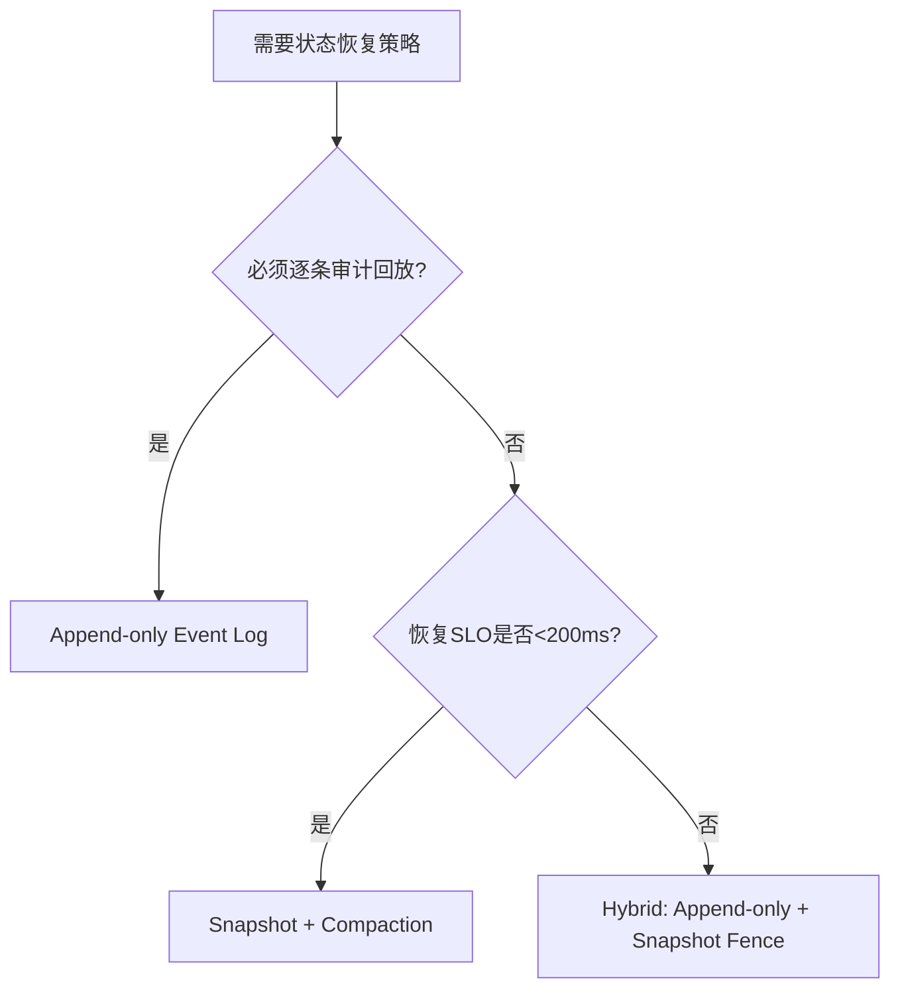
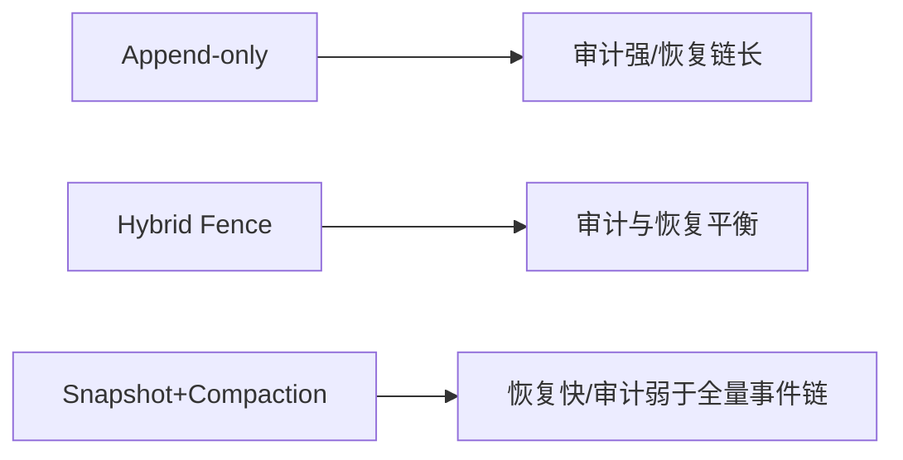
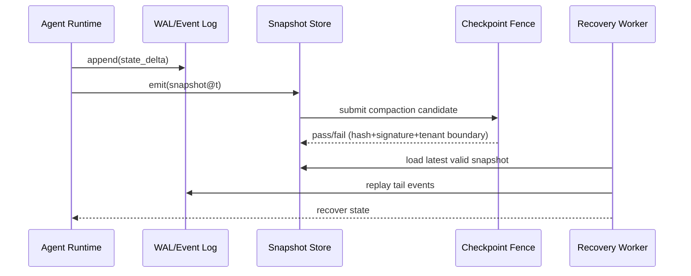

# Agent 状态检查点策略选型 FAQ（Append-only Event Log vs Snapshot + Compaction）

> 专题边界：仅讨论 **Agent 状态检查点策略**，不扩展到身份注入、模型路由或供应链主题。

## 1) 📌 核心结论速览（3 条）

1. **默认生产建议“追加事件日志 + 周期快照 + 受控压实”组合**，兼顾可追溯、恢复时延与存储成本。  
2. **纯 Append-only 最适合强审计场景**，但恢复链会随时间拉长，读放大明显。  
3. **纯 Snapshot+Compaction 最省恢复时间**，但若缺少事件链回放与校验围栏，法务审计与根因定位会变弱。  

## 2) 🎯 Q1 / Q2 / Q3（大白话 + 第一性原理）

### Q1：Append-only Event Log 是什么？什么时候优先？

- **大白话**：每次状态变化都当作“账本追加一条记录”，永不原地覆盖。  
- **第一性原理**：把“状态”拆成“变化序列”，可重放就可验证，可验证就可审计。  
- **适用场景**：金融零信任、合规取证、事故复盘必须可逐步重放的系统。  

### Q2：Snapshot + Compaction 是什么？什么时候优先？

- **大白话**：定期把当前状态拍成“快照”，再把旧日志压缩归档，减少恢复长度。  
- **第一性原理**：恢复成本≈回放长度；把回放段截断到最近快照后，可稳定恢复时延。  
- **适用场景**：高并发会话平台、强调恢复 SLO、希望控制存储增长的多租户 SaaS。  

### Q3：核心技术 X（Checkpoint Fence）怎么理解？

- **大白话**：Checkpoint Fence 就是“检查点围栏”——没有通过完整性校验的快照和压实结果，不允许进入生产读路径。  
- **第一性原理**：任何“更快”的状态恢复都不能破坏“可验证性”；先校验、后放行。  
- **运作链路**：事件追加 → 周期快照 → 压实候选 → 围栏校验（哈希/签名/租户边界）→ 放行或回滚。  

## 3) 🧭 Mermaid 可视化（决策树 TD + 路径 LR + 时序）

## 4) 📊 架构师决策矩阵

| 维度 | Append-only Event Log | Snapshot + Compaction |
|---|---|---|
| 审计/取证能力 | 极高 | 中 |
| 恢复时延稳定性 | 中-低（随链增长） | 高 |
| 存储增长压力 | 高 | 中-低 |
| 复杂度 | 中 | 中-高（需压实安全围栏） |
| 生产默认建议 | 合规优先场景 | ✅ 高并发恢复优先场景 |

## 5) 🧪 定量算例 + 7-Card 洞察

> 数据来源：`evidence/cycle-404-benchmark.json`（标签分层：`measured` / `synthetic` / `anonymized_reported`）。

| 指标 | Append-only 基线 | Snapshot+Compaction（带 Fence） |
|---|---:|---:|
| 状态恢复 P95 | 1360 ms | 158 ms |
| 检查点围栏拦截率 | 91.6% | 97.0% |
| 压实安全通过率 | 92.2% | 92.2% |
| 单会话成本（20 分钟） | $0.00996（Kata 路径） | $0.00483（E2B 快照路径） |
| 审计可追溯深度 | 全量事件链 | 快照+尾部回放 |

7-Card：`benchmark-cards.html` / `benchmark-cards.en.html`（CSP 自包含；坐标来自封存证据，缺失项标“未测”）

## 6) 🛠️ 生产核验 Checklist

- [ ] 明确 RPO/RTO 与审计保留期（按租户分层）
- [ ] 事件日志启用不可变写入与租户边界键
- [ ] 快照与压实产物必须经过 Checkpoint Fence 校验
- [ ] 恢复流程固定为“快照加载 + 尾部回放”，禁止旁路
- [ ] 对压实失败路径配置自动回滚与告警
- [ ] 周期回放抽样，核验审计链完整性
- [ ] 每次策略变更保留基准证据（latency/throughput/policy/cost）

