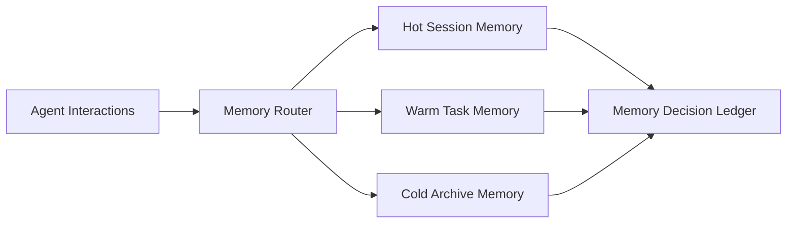

# Agent Stateful Memory Tiering Selection FAQ (Cycle 1794)

## 1) Three-minute decision
- **Memory-system drift is usually caused not by lack of storage, but by mismatched hot/cold tiering and retention policies.**
- **Recommendation:** hot short-session memory + warm task context memory + cold long-term audit archive.
- **Goal:** reduce token replay cost, stabilize retrieval latency, and satisfy retention compliance.

## 2) Core questions (Q1/Q2/Q3)
### Q1: Why does a single memory tier fail?
1) hot and cold data compete for read/write budget,
2) long histories slow retrieval,
3) delete/retention policy is hard to enforce by class.

### Q2: What tiering model is practical?
- Hot: short TTL, high hit-rate, low latency,
- Warm: task-level aggregation with topical indexing,
- Cold: compressed archive for low-frequency audits,
- Routing: choose tier by request intent and SLA.

### Q3: How to verify effectiveness?
- higher hot-tier hit rate with stable P95,
- explainable warm-tier recall,
- lower cold-tier retention cost while meeting compliance windows.

## 3) Reference architecture

## 4) Decision matrix
| Dimension | Single-tier memory | Tiered memory (Recommended) |
|---|---:|---:|
| Latency stability | Low | High |
| Cost control | Low | High |
| Retention governance | Medium | High |
| Retrieval explainability | Medium | High |
| Implementation complexity | Low | Medium |

## 5) Evidence and reproducibility
- Evidence files:
  - `workshops/azure-agent-infra/evidence/cycle-1794-benchmark.json`
  - `workshops/azure-agent-infra/evidence/cycle-1794-latency.csv`
  - `workshops/azure-agent-infra/evidence/cycle-1794-throughput.csv`
  - `workshops/azure-agent-infra/evidence/cycle-1794-policy.csv`
- Labels: `measured / synthetic / anonymized_reported`.
- validation7 covers structure fidelity, evidence consistency, CSP self-contained cards, and replayability checks.

## 6) Production checklist
- [ ] Hot/Warm/Cold TTL and retention policies are defined.
- [ ] Request routing is SLA/intent-aware.
- [ ] Warm-tier retrieval has explainable evidence links.
- [ ] Cold-tier audit query and deletion policy is enforceable.
- [ ] FAQ/H5/SVG/7-card are cycle-consistent with evidence.
