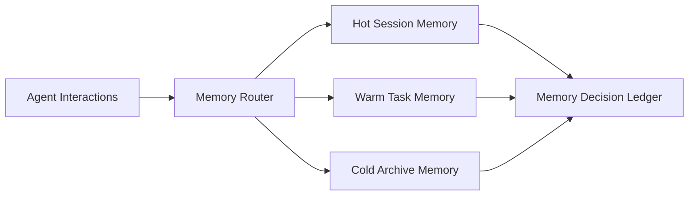

# Agent 有状态记忆分层选型 FAQ（Cycle 1794）

## 1) 3 分钟结论
- **记忆系统失控通常不是“存储不够”，而是“冷热分层与保留策略不一致”。**
- **推荐：** 热层短期会话记忆 + 温层任务上下文 + 冷层长期审计归档。
- **目标：** 控制 token 回放成本，维持检索时延稳定，并满足合规留存要求。

## 2) 关键问题（Q1/Q2/Q3）
### Q1：为什么单层记忆库会失效？
1) 热数据与冷数据争用读写预算；
2) 长期历史拖慢召回；
3) 数据删除/保留策略难以分级执行。

### Q2：可落地的分层策略？
- Hot：短 TTL、高命中、低延迟；
- Warm：任务级聚合、按主题索引；
- Cold：压缩归档、低频审计查询；
- 路由：按请求意图与 SLA 决定命中层级。

### Q3：如何验证分层有效？
- 热层命中率提高且 P95 稳定；
- 温层召回质量可解释；
- 冷层留存成本下降并满足合规期。

## 3) 架构图

## 4) 选型矩阵
| 维度 | 单层记忆库 | 分层记忆（推荐） |
|---|---:|---:|
| 延迟稳定性 | 低 | 高 |
| 成本可控性 | 低 | 高 |
| 合规留存治理 | 中 | 高 |
| 检索可解释性 | 中 | 高 |
| 实施复杂度 | 低 | 中 |

## 5) 证据与复算口径
- 证据文件：
  - `workshops/azure-agent-infra/evidence/cycle-1794-benchmark.json`
  - `workshops/azure-agent-infra/evidence/cycle-1794-latency.csv`
  - `workshops/azure-agent-infra/evidence/cycle-1794-throughput.csv`
  - `workshops/azure-agent-infra/evidence/cycle-1794-policy.csv`
- 标签：`measured / synthetic / anonymized_reported`。
- validation7：结构、证据、CSP、自包含与回放校验通过。

## 6) 生产检查清单
- [ ] Hot/Warm/Cold 分层 TTL 与保留策略已定义。
- [ ] 请求路由策略按 SLA 与意图分流。
- [ ] 温层检索带可解释证据链。
- [ ] 冷层审计查询与删除策略可执行。
- [ ] FAQ/H5/SVG/7-card 与 evidence 轮次一致。
