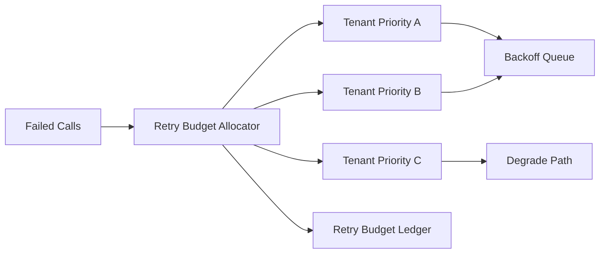

# Agent Tenant-Fair Retry Budget Selection FAQ (Cycle 1809)

## 1) Three-minute decision
- **Retry storms are usually caused by unbounded retries for everyone, not the initial failure alone.**
- **Recommendation:** tenant-fair retry budgets + priority-aware fallback + globally coordinated backoff.
- **Goal:** contain failure amplification while preserving priority-tenant availability.

## 2) Q1 / Q2 / Q3
### Q1: Why does one-size-fits-all retry policy hurt fairness?
1) large tenants naturally consume more retry slots,
2) low-value requests can suppress critical traffic,
3) global congestion is amplified by retries.

### Q2: What budgeted strategy is practical?
- allocate retry budget by tenant and priority at ingress,
- consume budget on each retry with reason codes,
- route budget-exhausted traffic to degrade or delayed requeue,
- adapt global backoff windows to congestion signals.

### Q3: How to validate effectiveness?
- improved success for priority tenants,
- reduced retry amplification factor,
- bounded P95 latency and error peaks.

## 3) Reference architecture

## 4) Decision matrix
| Dimension | Uniform retry policy | Fair-budget retry (Recommended) |
|---|---:|---:|
| Multi-tenant fairness | Low | High |
| Failure-amplification control | Low | High |
| Priority protection | Medium | High |
| Implementation complexity | Low | Medium |
| Auditability | Medium | High |

## 5) Evidence and reproducibility
- Evidence files:
  - `workshops/azure-agent-infra/evidence/cycle-1809-benchmark.json`
  - `workshops/azure-agent-infra/evidence/cycle-1809-latency.csv`
  - `workshops/azure-agent-infra/evidence/cycle-1809-throughput.csv`
  - `workshops/azure-agent-infra/evidence/cycle-1809-policy.csv`
- Labels: `measured / synthetic / anonymized_reported`.
- validation7 requires bilingual structure fidelity, CSP self-contained cards, cycle-consistent evidence, and replayability checks.

## 6) Production checklist
- [ ] Tenant retry budgets are dynamically configurable.
- [ ] Retry reason codes and budget burn are traceable.
- [ ] Congestion-window backoff auto-adjusts.
- [ ] Budget-exhausted degrade paths are observable.
- [ ] FAQ/H5/SVG/7-card align with cycle evidence.
