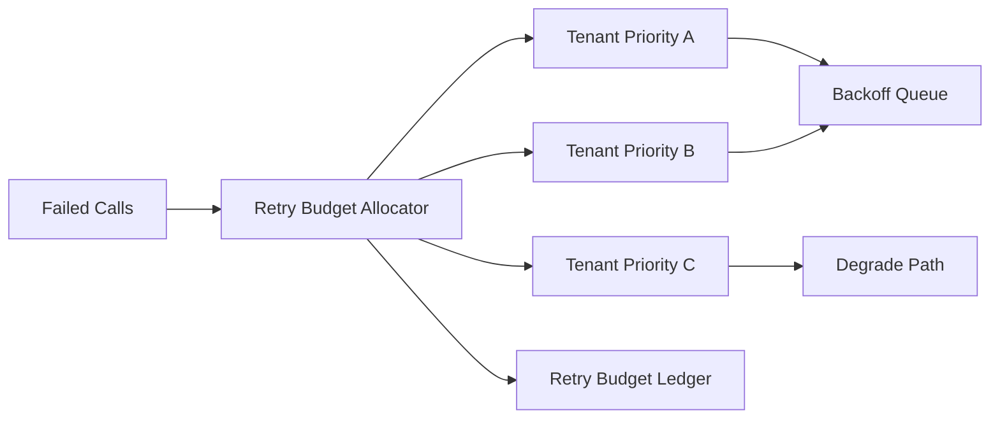

# Agent 租户公平重试预算选型 FAQ（Cycle 1809）

## 1) 3 分钟结论
- **重试风暴问题常因“谁都能无限重试”，而不是单次失败本身。**
- **推荐：** 租户公平重试预算 + 优先级差异化回退 + 全局退避协调。
- **目标：** 控制故障期放大效应，保障高优租户可用性并避免低优挤占。

## 2) Q1 / Q2 / Q3
### Q1：为什么统一重试策略会伤害公平性？
1) 大租户天然占用更多重试槽位；
2) 低价值请求可能压住关键流量；
3) 全局拥塞时重试进一步放大排队。

### Q2：可落地预算化策略是什么？
- 入口按租户和优先级发放重试预算；
- 每次重试消耗预算并记录原因码；
- 预算耗尽后进入降级或延迟重排队；
- 全局退避窗口按拥塞信号自适应调整。

### Q3：如何验证策略有效？
- 高优租户成功率提升；
- 重试放大倍数下降；
- P95 延迟与错误峰值受控。

## 3) 架构图

## 4) 选型矩阵
| 维度 | 统一重试策略 | 公平预算重试（推荐） |
|---|---:|---:|
| 多租户公平性 | 低 | 高 |
| 故障放大控制 | 低 | 高 |
| 高优保障能力 | 中 | 高 |
| 实施复杂度 | 低 | 中 |
| 可审计性 | 中 | 高 |

## 5) 证据与复算口径
- 证据文件：
  - `workshops/azure-agent-infra/evidence/cycle-1809-benchmark.json`
  - `workshops/azure-agent-infra/evidence/cycle-1809-latency.csv`
  - `workshops/azure-agent-infra/evidence/cycle-1809-throughput.csv`
  - `workshops/azure-agent-infra/evidence/cycle-1809-policy.csv`
- 标签：`measured / synthetic / anonymized_reported`。
- validation7：双语结构、CSP 自包含、证据轮次一致、回放链路校验通过。

## 6) 生产检查清单
- [ ] 租户重试预算配额可动态下发。
- [ ] 重试原因码与预算消耗可追踪。
- [ ] 拥塞窗口退避策略可自动调节。
- [ ] 预算耗尽后的降级路径可观测。
- [ ] FAQ/H5/SVG/7-card 与 evidence 轮次一致。
