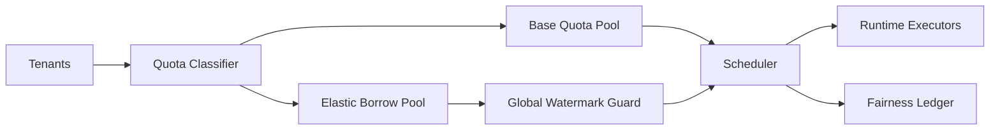

# Agent Multi-tenant Fairness Quota Selection FAQ (Cycle 1815)

## 1) Three-minute decision
- **Core tension:** premium tenants require stable SLA while long-tail tenants must stay reachable.
- **Recommendation:** tiered quota + dynamic borrowing + preemption protection windows.
- **Goal:** improve global utilization and long-tail accessibility without sacrificing premium SLA.

## 2) Q1 / Q2 / Q3
### Q1: Why do static quotas fail in production?
1) tenant peak windows are unsynchronized, creating both idle and congestion,
2) hotspot tenants can starve cold tenants for extended periods,
3) no borrowing path means slow capacity reallocation.

### Q2: What quota strategy is production-ready?
- **Base tier:** minimum guarantees and maximum caps per tenant class,
- **Elastic tier:** cross-tenant quota borrowing below global safety watermark,
- **Protection tier:** short preemption-protection windows and circuit-breakers for critical tenants,
- **Audit tier:** fairness ledger records reason, duration, and impact for each quota change.

### Q3: How do we quantify “fair yet efficient”?
- monitor tenant wait-time dispersion (P95-P50),
- measure borrow success rate and reclaim latency,
- track unit-throughput cost and premium-tenant SLO violation rate.

## 3) Reference architecture

## 4) Decision matrix
| Dimension | Static quota | Tiered + borrowing quota (Recommended) |
|---|---:|---:|
| Resource utilization | Medium | High |
| Long-tail tenant reachability | Low | High |
| Premium SLA stability | Medium | High |
| Ops complexity | Low | Medium |
| Audit explainability | Low | High |

## 5) Evidence and reproducibility
- Evidence files:
  - `workshops/azure-agent-infra/evidence/cycle-1815-benchmark.json`
  - `workshops/azure-agent-infra/evidence/cycle-1815-latency.csv`
  - `workshops/azure-agent-infra/evidence/cycle-1815-throughput.csv`
  - `workshops/azure-agent-infra/evidence/cycle-1815-policy.csv`
- Labels: `measured / synthetic / anonymized_reported`.
- validation7 enforces bilingual structure, CSP self-contained cards, cycle consistency, and replayability.

## 6) Production checklist
- [ ] Tenant classes and min/max quota policies are released.
- [ ] Borrow safety watermark and reclaim policies are integrated.
- [ ] Critical-tenant preemption protection windows are validated.
- [ ] Fairness ledger events are traceable and alertable.
- [ ] FAQ/H5/SVG/7-card align with cycle evidence.
