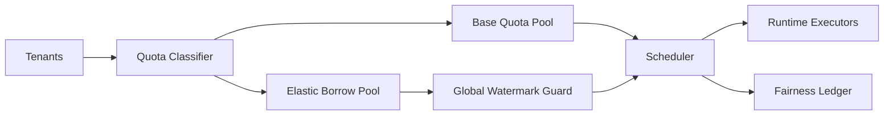

# Agent 多租户公平配额选型 FAQ（Cycle 1815）

## 1) 3 分钟结论
- **核心矛盾：** 高价值租户需要稳定 SLA，但平台又必须保障长尾租户可用性。
- **推荐：** 分层配额 + 动态借额 + 抢占保护窗口的三段治理。
- **目标：** 在不牺牲头部 SLA 的前提下，提高整体资源利用率与尾租户可达性。

## 2) Q1 / Q2 / Q3
### Q1：为什么静态配额经常失效？
1) 租户峰值时段不同步，静态上限导致空转和拥塞并存；
2) 热租户突发会把冷租户长期挤出队列；
3) 无借额机制时，容量回收与再分配滞后。

### Q2：生产可落地的公平配额策略是什么？
- **基础层**：按租户等级设最小保底和最大上限；
- **弹性层**：在全局水位安全线下开放跨租户借额；
- **保护层**：为关键租户设置短时抢占保护窗口与熔断策略；
- **审计层**：每次配额变更写入公平账本（原因、时长、影响面）。

### Q3：如何量化“公平且不浪费”？
- 观察租户等待时间离散度（P95-P50）；
- 统计借额成功率与回收时延；
- 评估单位吞吐成本和关键租户违约率。

## 3) 架构图

## 4) 选型矩阵
| 维度 | 静态配额 | 分层+借额配额（推荐） |
|---|---:|---:|
| 资源利用率 | 中 | 高 |
| 尾租户可达性 | 低 | 高 |
| 关键租户 SLA 稳定性 | 中 | 高 |
| 运维复杂度 | 低 | 中 |
| 审计可解释性 | 低 | 高 |

## 5) 证据与复算口径
- 证据文件：
  - `workshops/azure-agent-infra/evidence/cycle-1815-benchmark.json`
  - `workshops/azure-agent-infra/evidence/cycle-1815-latency.csv`
  - `workshops/azure-agent-infra/evidence/cycle-1815-throughput.csv`
  - `workshops/azure-agent-infra/evidence/cycle-1815-policy.csv`
- 标签：`measured / synthetic / anonymized_reported`。
- validation7：双语结构完整、CSP 自包含、轮次一致、证据链可回放。

## 6) 生产检查清单
- [ ] 租户等级与保底/上限策略已发布。
- [ ] 借额安全线与回收策略已联调。
- [ ] 关键租户抢占保护窗口已验证。
- [ ] 公平账本记录可追溯并具备告警。
- [ ] FAQ/H5/SVG/7-card 与 evidence 轮次一致。
