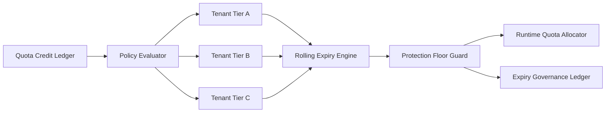

# Agent Tenant Quota Credit Expiry Selection FAQ (Cycle 1834)

## 1) Three-minute decision
- **Core tension:** non-expiring credits accumulate risk, while aggressive expiry can cause tenant experience cliffs.
- **Recommendation:** tiered credit expiry plus rolling reclamation plus critical-tenant protection floors.
- **Goal:** reduce resource-risk exposure while preserving predictable tenant quota experience.

## 2) Q1 / Q2 / Q3
### Q1: Why are "never expire" and "uniform expiry" both problematic?
1) non-expiring credits enlarge peak exposure,
2) uniform expiry concentrates compensation demand,
3) no tenant tiering harms critical-business continuity.

### Q2: What production-ready expiry strategy should be used?
- **Tiered periods:** different credit validity windows by tenant tier,
- **Rolling reclamation:** daily or weekly rolling expiry to avoid cliff events,
- **Protection floor:** minimum retained credit floor for critical tenants,
- **Transparent ledger:** track issuance, usage, expiry, and compensation events.

### Q3: How do we validate lower risk with stable experience?
- reduced peak credit exposure,
- bounded complaint rate around expiry windows,
- stable availability metrics for critical tenants.

## 3) Reference architecture

## 4) Decision matrix
| Dimension | Non-expiring or uniform expiry | Tiered rolling expiry (Recommended) |
|---|---:|---:|
| Peak-risk control | Low | High |
| Tenant experience stability | Low | High |
| Critical-business protection | Medium | High |
| Implementation complexity | Low | Medium |
| Operational explainability | Medium | High |

## 5) Evidence and reproducibility
- Evidence files:
  - `workshops/azure-agent-infra/evidence/cycle-1834-benchmark.json`
  - `workshops/azure-agent-infra/evidence/cycle-1834-latency.csv`
  - `workshops/azure-agent-infra/evidence/cycle-1834-throughput.csv`
  - `workshops/azure-agent-infra/evidence/cycle-1834-policy.csv`
- Labels: `measured / synthetic / anonymized_reported`.
- validation7 enforces bilingual six-part structure, CSP self-contained 7-card output, strict cycle-evidence alignment, and replayability.

## 6) Production checklist
- [ ] Tiered tenant validity windows are released.
- [ ] Rolling reclaim windows and throttling rules are integrated.
- [ ] Critical-tenant protection floors are validated.
- [ ] Expiry ledger, compensation, and alert flows are traceable.
- [ ] FAQ/H5/SVG/7-card align with cycle evidence.
