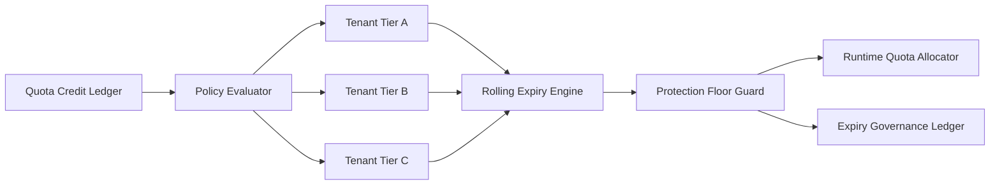

# Agent 租户配额积分到期策略选型 FAQ（Cycle 1834）

## 1) 3 分钟结论
- **核心矛盾：** 不设积分到期会导致历史额度长期沉积并放大突发风险；到期过急又会引发租户体验断崖。
- **推荐：** 分层积分到期 + 平滑回收 + 关键租户保护阈值。
- **目标：** 在控制资源风险的同时保持租户配额体验稳定。

## 2) Q1 / Q2 / Q3
### Q1：为什么“永久积分”或“统一到期”都不理想？
1) 永久积分会抬高系统峰值暴露；
2) 统一到期会在同一时点引发大量补偿请求；
3) 不区分租户等级会损伤关键业务连续性。

### Q2：可落地的积分到期策略是什么？
- **分层周期**：按租户等级配置不同积分有效期；
- **平滑回收**：按日或按周滚动回收，避免集中到期；
- **保护阈值**：为关键租户保留最低可用积分底座；
- **透明账本**：记录积分生成、消耗、到期和补偿事件。

### Q3：如何验证“风险下降且体验稳定”？
- 峰值额度暴露下降；
- 到期窗口投诉率受控；
- 关键租户可用性指标稳定。

## 3) 架构图

## 4) 选型矩阵
| 维度 | 永久或统一到期 | 分层平滑到期（推荐） |
|---|---:|---:|
| 峰值风险控制 | 低 | 高 |
| 租户体验稳定性 | 低 | 高 |
| 关键业务保护 | 中 | 高 |
| 实施复杂度 | 低 | 中 |
| 运营可解释性 | 中 | 高 |

## 5) 证据与复算口径
- 证据文件：
  - `workshops/azure-agent-infra/evidence/cycle-1834-benchmark.json`
  - `workshops/azure-agent-infra/evidence/cycle-1834-latency.csv`
  - `workshops/azure-agent-infra/evidence/cycle-1834-throughput.csv`
  - `workshops/azure-agent-infra/evidence/cycle-1834-policy.csv`
- 标签：`measured / synthetic / anonymized_reported`。
- validation7：双语六段结构、7-card CSP 自包含、轮次与 evidence 一致、可回放链路通过。

## 6) 生产检查清单
- [ ] 租户分层有效期策略已发布。
- [ ] 平滑回收窗口与节流规则已联调。
- [ ] 关键租户底座阈值已验证。
- [ ] 到期账本、补偿与告警链路可追溯。
- [ ] FAQ/H5/SVG/7-card 与 evidence 轮次一致。
