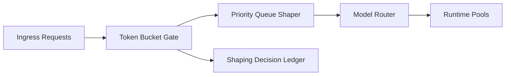

# Agent Token Burst Shaping Selection FAQ (Cycle 1798)

## 1) Three-minute decision
- **Gateway instability is often triggered by burst token spikes, not high average request rates.**
- **Recommendation:** ingress token buckets + tenant burst quotas + priority queue shaping.
- **Goal:** preserve high-priority throughput while reducing tail latency and rejection spikes.

## 2) Core questions (Q1/Q2/Q3)
### Q1: Why is QPS-only throttling insufficient?
1) token volume varies heavily at equal QPS,
2) long-context requests crowd out short requests,
3) peak windows amplify downstream model queueing.

### Q2: What is a practical production strategy?
- throttle on token budget, not request count alone,
- reserve burst capacity for critical tenants,
- shape by priority queues with timeout fallback,
- log shaping decisions for tuning and audits.

### Q3: How to validate effectiveness?
- lower P95/P99 latency,
- stable success rate for high-priority tenants,
- bounded per-session token-cost variance.

## 3) Reference architecture

## 4) Decision matrix
| Dimension | QPS-only throttling | Token burst shaping (Recommended) |
|---|---:|---:|
| Peak stability | Low | High |
| Priority protection | Medium | High |
| Cost controllability | Medium | High |
| Tuning complexity | Low | Medium |
| Observability | Medium | High |

## 5) Evidence and reproducibility
- Evidence files:
  - `workshops/azure-agent-infra/evidence/cycle-1798-benchmark.json`
  - `workshops/azure-agent-infra/evidence/cycle-1798-latency.csv`
  - `workshops/azure-agent-infra/evidence/cycle-1798-throughput.csv`
  - `workshops/azure-agent-infra/evidence/cycle-1798-policy.csv`
- Labels: `measured / synthetic / anonymized_reported`.
- validation7 requires bilingual structure fidelity, CSP self-contained cards, cycle-consistent evidence, and replayability checks.

## 6) Production checklist
- [ ] Token budget thresholds are tiered by tenant/SLA.
- [ ] Priority shaping and timeout policies are load-tested.
- [ ] Peak fallback and circuit-breaker behavior is executable.
- [ ] Shaping decision ledger is auditable.
- [ ] FAQ/H5/SVG/7-card align with cycle evidence.
