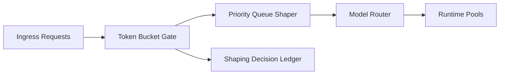

# Agent Token 突发整形选型 FAQ（Cycle 1798）

## 1) 3 分钟结论
- **大模型网关抖动常由“瞬时 token 峰值”触发，而非平均流量过高。**
- **推荐：** 入口 token 桶 + 租户突发配额 + 优先级队列整形。
- **目标：** 在保障高优业务吞吐的同时，抑制尾延迟和拒绝率飙升。

## 2) 关键问题（Q1/Q2/Q3）
### Q1：为什么只做 QPS 限流不够？
1) 同一 QPS 下 token 体积差异巨大；
2) 长上下文请求会挤占短请求资源；
3) 峰值窗口中下游模型排队放大。

### Q2：生产可落地策略？
- 入口按 token 预算而非仅按请求数限流；
- 为关键租户预留突发额度；
- 按优先级做排队整形与超时回退；
- 记录每次整形决策用于审计与调参。

### Q3：如何验证策略有效？
- P95/P99 延迟下降；
- 高优租户成功率稳定；
- 单会话 token 成本波动收敛。

## 3) 架构图

## 4) 选型矩阵
| 维度 | 仅 QPS 限流 | Token 突发整形（推荐） |
|---|---:|---:|
| 峰值稳定性 | 低 | 高 |
| 高优业务保障 | 中 | 高 |
| 成本可控性 | 中 | 高 |
| 调参复杂度 | 低 | 中 |
| 可观测性 | 中 | 高 |

## 5) 证据与复算口径
- 证据文件：
  - `workshops/azure-agent-infra/evidence/cycle-1798-benchmark.json`
  - `workshops/azure-agent-infra/evidence/cycle-1798-latency.csv`
  - `workshops/azure-agent-infra/evidence/cycle-1798-throughput.csv`
  - `workshops/azure-agent-infra/evidence/cycle-1798-policy.csv`
- 标签：`measured / synthetic / anonymized_reported`。
- validation7：双语结构、CSP 自包含、证据轮次一致与回放链路检查通过。

## 6) 生产检查清单
- [ ] token 预算阈值按租户/SLA 分级。
- [ ] 优先级队列整形与超时策略已压测。
- [ ] 峰值回退模板与熔断策略可执行。
- [ ] 整形决策审计账本可追溯。
- [ ] FAQ/H5/SVG/7-card 与 evidence 轮次一致。
