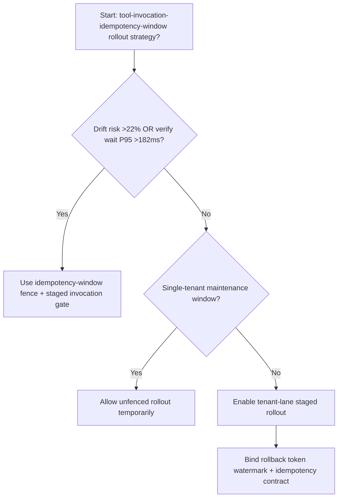
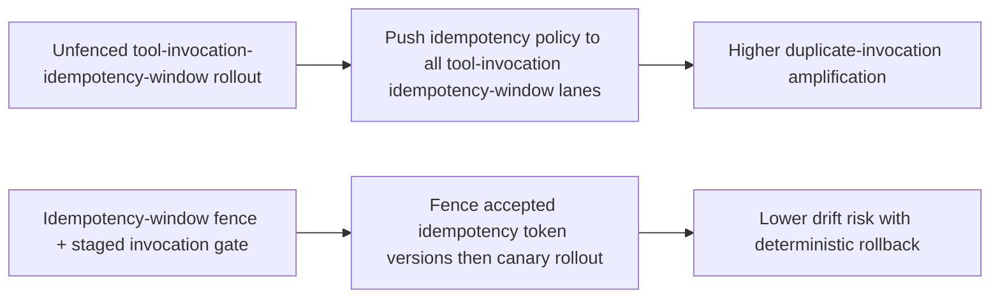
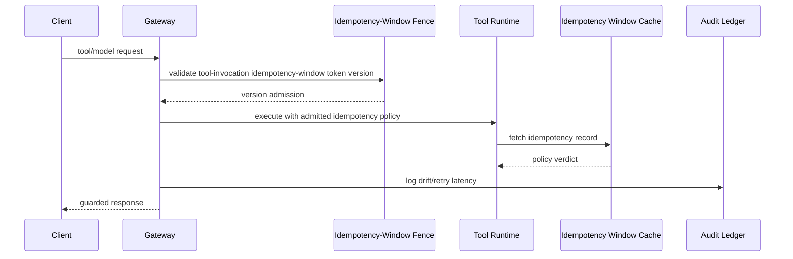

# Agent Tool Invocation Idempotency Window 选型 FAQ（Unfenced Invocation Rollout vs Idempotency-Window Fence + Staged Invocation Gate）

## 1) 核心结论（先给负责人）
- **当 tool invocation idempotency 重复调用风险 >22% 且校验等待 P95 >182ms 时，生产默认应启用 Idempotency-Window Fence + Staged Invocation Gate**。
- **当未围栏 tool invocation idempotency window 重复调用率 >12% 且回退重试 P95 >252ms 时，Unfenced Invocation Rollout 会进入 12.1% 重复调用放大区间**。
- **多租户运行时必须绑定“idempotency-window 围栏、灰度批次、回滚阈值”**，否则策略执行与吞吐稳定性会同步退化。

## 2) Q1 / Q2 / Q3（术语先通俗解释）
- **Unfenced Invocation Rollout**：直接把新策略缓存推到所有 tool invocation idempotency window 节点，快但风险高。
- **Idempotency-Window Fence + Staged Invocation Gate**：先限制可接受的 idempotency token 版本，再按批次切流。

### Q1：为什么 tool invocation idempotency window 一致性会影响 Agent 稳定性？
第一性原理：tool invocation idempotency window 层承担策略判定与流量治理。idempotency token 版本漂移会导致节点间执行分叉，放大重试与尾延迟。

### Q2：什么时候可以短时用 Unfenced 方案？
仅限单租户低流量维护窗；多租户生产应默认启用idempotency-window 围栏。

### Q3：最小闭环是什么？
版本采样 -> 围栏校验 -> 分批放量 -> 漂移告警 -> 自动回滚。

## 3) Mermaid（决策树 / 路径对比 / 时序）
### 3.1 选型决策树

### 3.2 路径对比图

### 3.3 运行时序图

## 4) 选型决策矩阵
| 维度 | Unfenced Invocation Rollout | Idempotency-Window Fence + Staged Invocation Gate |
|---|---|---|
| 实现复杂度 | 低 | 中 |
| 重复调用风险 | 高 | 低 |
| 多租户可控性 | 低 | 高 |
| 回滚确定性 | 中 | 高 |
| 生产默认建议 | 仅维护窗 | 长期默认 |

## 5) 数据证据与可复算算例（含 n/分母/来源）
> 本节百分比为 `synthetic_assumed` 假设算例（hypothetical），用于机制比较；生产机制认证保持 `not_measured`。  
> 合同字段见：`workshops/azure-agent-infra/evidence/cycle-550-benchmark.json` 的 `percentage_contract`。

- 指标 A（未围栏 tool invocation idempotency window 重复调用率）  
  - 定义：`n_unfenced_tool_invocation_duplicate / n_gateway_requests_observed`  
  - 值：`534/4410 = 12.1%`（`synthetic_assumed`）  
  - 路径：`percentage_contract.unfenced_tool_invocation_duplicate_rate`
- 指标 B（idempotency-window 围栏重复调用率）  
  - 定义：`n_idempotency_window_fence_duplicate / n_gateway_requests_observed`  
  - 值：`216/4410 = 4.9%`（`synthetic_assumed`）  
  - 路径：`percentage_contract.idempotency_window_fence_duplicate_rate`
- 指标 C（恢复增益，百分点）  
  - 定义：`n_idempotency_window_fence_recovery_gain / n_gateway_requests_observed`  
  - 值：`330/4410 = 7.5` 个百分点（`synthetic_assumed`）  
  - 路径：`percentage_contract.idempotency_window_fence_recovery_gain_pts`

## 6) 生产 Checklist（上线前必须打勾）
- [ ] 每租户都有 tool invocation idempotency window 版本白名单与切流批次
- [ ] 漂移率、重试时延、回滚成功率可观测可审计
- [ ] 支持灰度、快速回退与分层放量
- [ ] 指标全部标注 `synthetic_assumed`，生产机制认证保持 `not_measured`
