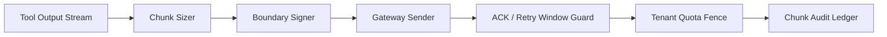

# Agent Tool Output Chunking Window Selection FAQ (Fixed Large Chunks vs Adaptive Chunking Windows)

## 1) Core conclusions
- **Adaptive chunking windows should be the production default for multi-tenant tool-output paths**.
- **Fixed large chunks amplify retry storms and gateway timeout risk** under burst traffic.
- **Chunking policy must bind tenant quotas, boundary signatures, and retry-window controls**, or consistency and cost drift.

## 2) Q1 / Q2 / Q3 (plain terms first)
- **Fixed large chunks**: tool outputs are sent in coarse, mostly static chunk sizes.
- **Adaptive chunking windows**: chunk sizes and send cadence are adjusted by latency, queue pressure, and tenant budgets.

### Q1: Why do fixed large chunks fail under concurrency?
First principle: when chunks are oversized, any jitter forces expensive retransmission of large payload units, magnifying retries and tail latency.

### Q2: When are fixed large chunks still acceptable?
Short-lived single-tenant flows with stable networks, predictable output sizes, and tolerance for occasional tail spikes.

### Q3: What is the minimum safe control loop?
Chunk sizing -> boundary signing -> send/ack -> adaptive window tuning -> retry-window suppression.

## 3) Mermaid (chunk-governance loop)

## 4) Decision matrix
| Dimension | Fixed large chunks | Adaptive chunking windows |
|---|---|---|
| Implementation complexity | Low | Medium-High |
| Retry amplification control | Low | High |
| Tail-latency stability | Medium-Low | High |
| Audit traceability | Medium | High |
| Default production fit | Short low-risk experiments | Multi-tenant long-running workloads |

## 5) Evidence contract + recomputable examples (n/denominator/source)
> Percentages in this section are `synthetic_assumed` hypothetical examples for mechanism comparison; production mechanism validation remains `not_measured`.  
> Contract fields: `workshops/azure-agent-infra/evidence/cycle-425-benchmark.json` -> `percentage_contract`.

- Metric A (oversized-chunk retry rate, fixed chunks)  
  - Formula: `n_retry_oversized_fixed / n_sessions_observed`  
  - Value: `256/2000 = 12.8%` (`synthetic_assumed`)  
  - Path: `percentage_contract.oversized_chunk_retry_rate`
- Metric B (retry rate, adaptive windows)  
  - Formula: `n_retry_adaptive / n_sessions_observed`  
  - Value: `62/2000 = 3.1%` (`synthetic_assumed`)  
  - Path: `percentage_contract.adaptive_chunk_retry_rate`
- Metric C (chunking efficiency gain, percentage points)  
  - Formula: `(n_success_adaptive - n_success_fixed) / n_sessions_observed`  
  - Value: `(1704-1480)/2000 = 11.2 percentage points` (`synthetic_assumed`)  
  - Path: `percentage_contract.chunking_efficiency_gain_pts`

## 6) Production checklist
- [ ] Chunk-window policy is versioned with rollout and rollback controls
- [ ] Boundary signatures and retry-window controls are auditable and replay-safe
- [ ] Tenant-level chunk budgets and quota gates are enforced at gateway level
- [ ] Metrics are tagged `synthetic_assumed` with denominator and units; production validation remains `not_measured`
