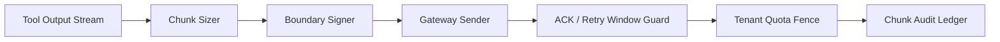

# Agent 工具输出分块窗口选型 FAQ（固定大块输出 vs 自适应分块窗口）

## 1) 核心结论（先给负责人）
- **多租户生产默认采用自适应分块窗口**，不建议固定大块输出。
- **固定大块会放大重试放大效应与网关超时概率**，并拖慢下游工具链恢复。
- **分块策略必须绑定租户配额、边界签名与重试窗口控制**，否则一致性和成本不可控。

## 2) Q1 / Q2 / Q3（术语先通俗解释）
- **固定大块输出**：每次工具结果按大体积块写回，块大小变化很小或不变化。
- **自适应分块窗口**：根据链路延迟、队列压力和租户预算动态调整块大小与发送节奏。

### Q1：为什么固定大块在高并发下会失败？
第一性原理：单次块过大时，任意链路抖动都会触发整块重传，导致重试量和尾延迟同时上升。

### Q2：什么时候还能接受固定大块？
单租户、链路稳定、输出规模可预测且可容忍较高尾延迟时，可作为短期策略。

### Q3：自适应分块窗口的最小安全闭环是什么？
输出分块 -> 边界签名 -> 发送与确认 -> 自适应窗口调整 -> 重试窗口抑制；缺任一步都可能引入重放或丢块风险。

## 3) Mermaid（分块治理闭环）

## 4) 决策矩阵
| 维度 | 固定大块输出 | 自适应分块窗口 |
|---|---|---|
| 实现复杂度 | 低 | 中-高 |
| 重试放大控制 | 低 | 高 |
| 尾延迟稳定性 | 中-低 | 高 |
| 审计可追溯性 | 中 | 高 |
| 生产默认建议 | 短期低风险实验 | 多租户长期运行 |

## 5) 数据证据与可复算算例（含 n/分母/来源）
> 本节百分比为 `synthetic_assumed` 假设算例（hypothetical），用于机制比较；生产机制认证仍为 `not_measured`。  
> 合同字段见：`workshops/azure-agent-infra/evidence/cycle-425-benchmark.json` 的 `percentage_contract`。

- 指标 A（超大块重试率，固定大块）  
  - 定义：`n_retry_oversized_fixed / n_sessions_observed`  
  - 值：`256/2000 = 12.8%`（`synthetic_assumed`）  
  - 路径：`percentage_contract.oversized_chunk_retry_rate`
- 指标 B（重试率，自适应窗口）  
  - 定义：`n_retry_adaptive / n_sessions_observed`  
  - 值：`62/2000 = 3.1%`（`synthetic_assumed`）  
  - 路径：`percentage_contract.adaptive_chunk_retry_rate`
- 指标 C（分块效率提升，百分点）  
  - 定义：`(n_success_adaptive - n_success_fixed) / n_sessions_observed`  
  - 值：`(1704-1480)/2000 = 11.2` 个百分点（`synthetic_assumed`）  
  - 路径：`percentage_contract.chunking_efficiency_gain_pts`

## 6) 生产 Checklist（上线前必须打勾）
- [ ] 分块窗口策略有版本、灰度与回滚路径  
- [ ] 边界签名与重试窗口控制可审计并支持追溯  
- [ ] 租户级分块预算与配额门禁在网关层生效  
- [ ] 指标口径已标注 `synthetic_assumed` 与分母/单位，生产机制认证保持 `not_measured`  
