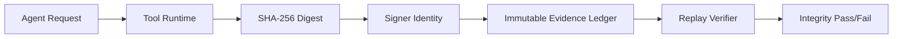

# Agent 工具输出哈希证明选型 FAQ（仅日志留痕 vs 哈希签名可验证链）

## 1) 核心结论（负责人速读）
- **跨系统、跨租户流程默认使用“哈希+签名+回放验证”链**，仅日志不足以支撑抗抵赖。
- **仅日志留痕仅适合低风险内网流程**，不适合作为争议仲裁证据主链。
- **生产门禁应要求“哈希可重算 + 签名可验 + 证据可回放”三项同时成立**。

## 2) Q1 / Q2 / Q3（术语先通俗解释）
- **日志留痕**：只记“谁调用了什么”，不保证结果没被改。
- **哈希证明链**：对结果算哈希并签名，再写入不可变账本，后续可回放验证。

### Q1：为什么“有日志”不等于“可证明”？
第一性原理：日志描述事件，但不绑定结果字节级完整性；哈希+签名才建立可验证完整性。

### Q2：什么时候仅日志仍可接受？
仅在低风险、低争议、单团队内部流程，且不要求对外审计抗抵赖时可接受。

### Q3：哈希证明链最小闭环是什么？
生成结果 -> 计算摘要 -> 签名摘要 -> 账本写入 -> 审计回放重算并验签。

## 3) Mermaid（证明链流程）

## 4) 决策矩阵
| 维度 | 仅日志留痕 | 哈希签名可验证链 |
|---|---|---|
| 实施复杂度 | 低 | 中 |
| 字节级完整性证明 | 低 | 高 |
| 审计抗抵赖 | 低 | 高 |
| 跨系统一致性 | 中 | 高 |
| 默认建议 | 低风险内部流程 | 生产跨域流程 |

## 5) 数据证据与可复算算例（含 n/分母/来源）
> 本节百分比全部为 `synthetic_assumed` 假设算例（hypothetical examples），用于可复算说明；  
> 生产真实争议工单闭环为 `not_measured`。  
> 合同字段见：`workshops/azure-agent-infra/evidence/cycle-418-benchmark.json` 的 `percentage_contract`。

- 指标 A（仅日志首次定责率）  
  - 定义：`n_first_pass_log_only / n_disputes`  
  - 值：`25/40 = 62.5%`（`synthetic_assumed`，hypothetical）  
  - 路径：`percentage_contract.log_only_first_pass_attribution_rate`
- 指标 B（哈希证明链首次定责率）  
  - 定义：`n_first_pass_attested / n_disputes`  
  - 值：`37/40 = 92.5%`（`synthetic_assumed`，hypothetical）  
  - 路径：`percentage_contract.attested_first_pass_attribution_rate`
- 指标 C（首次定责率提升，百分点）  
  - 定义：`(n_first_pass_attested - n_first_pass_log_only) / n_disputes`  
  - 值：`(37-25)/40 = 30.0` 个百分点（`synthetic_assumed`）  
  - 路径：`percentage_contract.attested_gain_vs_log_only`

## 6) 生产 Checklist（上线前必须打勾）
- [ ] 哈希算法、签名身份、证据保留期已版本化  
- [ ] 回放验证流程可在审计环境独立运行  
- [ ] 失败样本可追溯到原始 payload 和签名材料  
- [ ] 本轮指标已标注 `synthetic_assumed`（假设样例）且注明分母与单位，生产状态 `not_measured`  
