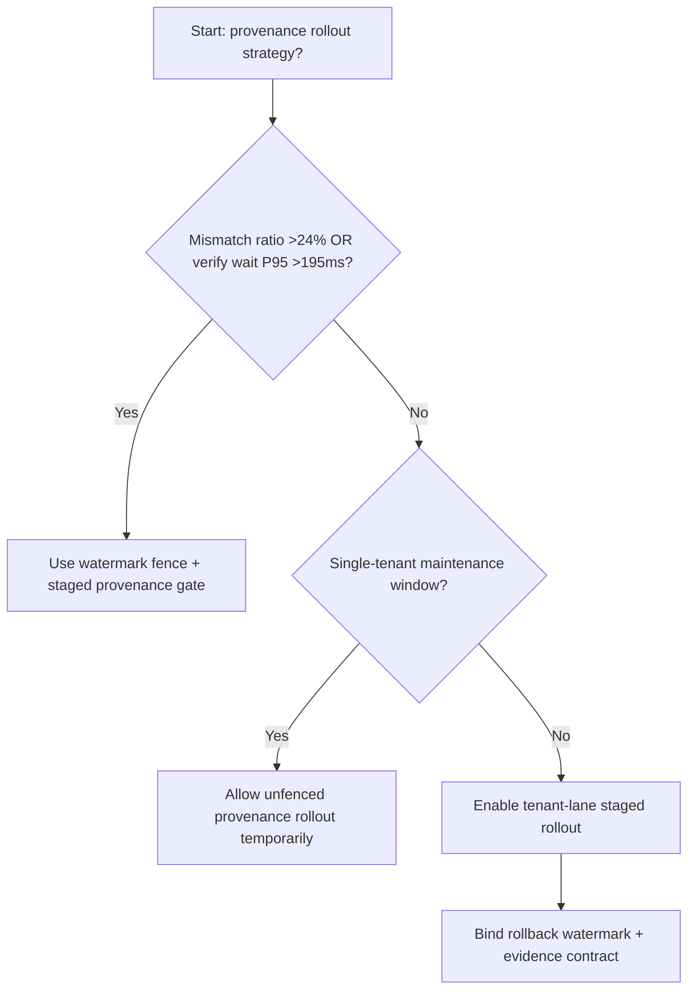
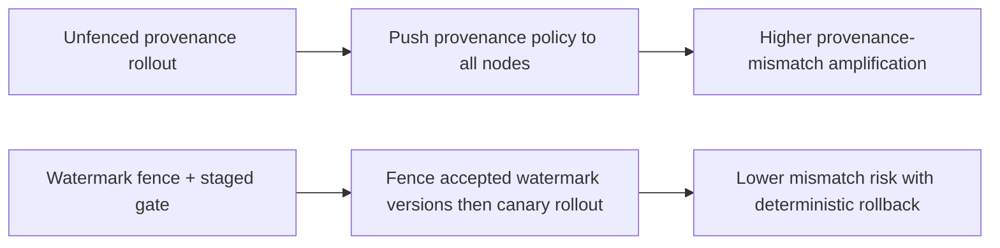
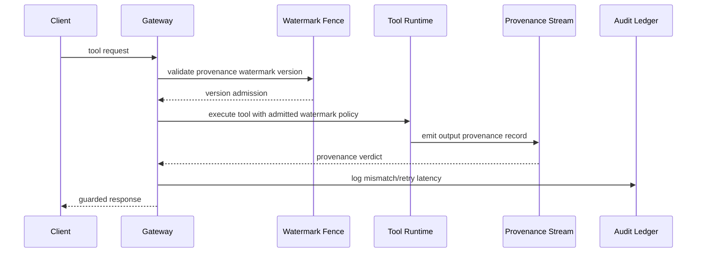

# Agent Tool Output Provenance Watermark Fence Selection FAQ (Unfenced Provenance Rollout vs Watermark Fence + Staged Provenance Gate)

## 1) Core conclusions (for decision-makers first)
- **When tool-output provenance mismatch exceeds 24% and verification wait P95 exceeds 195ms, production should default to Watermark Fence + Staged Provenance Gate**.
- **When unfenced provenance-rollout mismatch exceeds 13% and rollback retry P95 exceeds 265ms, Unfenced Provenance Rollout enters the 13.0% mismatch amplification band**.
- **Multi-tenant tool orchestration must bind watermark fences, rollout batches, and rollback thresholds**, or evidence-chain quality and policy interception destabilize together.

## 2) Q1 / Q2 / Q3 (plain-language definitions first)
- **Unfenced Provenance Rollout**: push new provenance policy to all gateway nodes directly; fast but risky.
- **Watermark Fence + Staged Provenance Gate**: constrain accepted provenance-watermark versions first, then shift traffic in batches.

### Q1: Why does provenance-watermark versioning affect agent reliability?
First principles: tool outputs pass both policy and audit validation. Watermark-version mismatch makes equivalent requests resolve with divergent verdicts across nodes, amplifying retries and tail latency.

### Q2: When is unfenced rollout acceptable temporarily?
Only in single-tenant low-traffic maintenance windows. Multi-tenant production should default to watermark-fenced rollout.

### Q3: What is the minimum safe loop?
Version sampling -> fence validation -> staged rollout -> mismatch alerts -> automated rollback.

## 3) Mermaid (decision tree / path comparison / sequence)
### 3.1 Selection decision tree

### 3.2 Path comparison

### 3.3 Runtime sequence

## 4) Decision matrix
| Dimension | Unfenced Provenance Rollout | Watermark Fence + Staged Provenance Gate |
|---|---|---|
| Implementation complexity | Low | Medium |
| Provenance-mismatch risk | High | Low |
| Multi-tenant controllability | Low | High |
| Rollback determinism | Medium | High |
| Default production fit | Maintenance windows only | Long-term default |

## 5) Evidence contract + recomputable examples (n/denominator/source)
> Percentages in this section are `synthetic_assumed` hypothetical examples for mechanism comparison; production mechanism validation remains `not_measured`.  
> Contract fields: `workshops/azure-agent-infra/evidence/cycle-545-benchmark.json` -> `percentage_contract`.

- Metric A (unfenced provenance mismatch rate)  
  - Formula: `n_unfenced_provenance_mismatch / n_gateway_requests_observed`  
  - Value: `573/4410 = 13.0%` (`synthetic_assumed`)  
  - Path: `percentage_contract.unfenced_provenance_mismatch_rate`
- Metric B (watermark-fence mismatch rate)  
  - Formula: `n_watermark_fence_mismatch / n_gateway_requests_observed`  
  - Value: `229/4410 = 5.2%` (`synthetic_assumed`)  
  - Path: `percentage_contract.watermark_fence_mismatch_rate`
- Metric C (recovery gain, percentage points)  
  - Formula: `(n_recovered_watermark_fence - n_recovered_unfenced) / n_gateway_requests_observed`  
  - Value: `(4098-3765)/4410 = 7.6 percentage points` (`synthetic_assumed`)  
  - Path: `percentage_contract.watermark_fence_recovery_gain_pts`

## 6) Production checklist
- [ ] Every tenant has provenance-watermark version allow-lists and rollout batches
- [ ] Mismatch rate, retry latency, and rollback success are observable and auditable
- [ ] Change flow supports canary rollout, fast rollback, and tiered promotion
- [ ] All metrics are tagged `synthetic_assumed`; production validation remains `not_measured`
