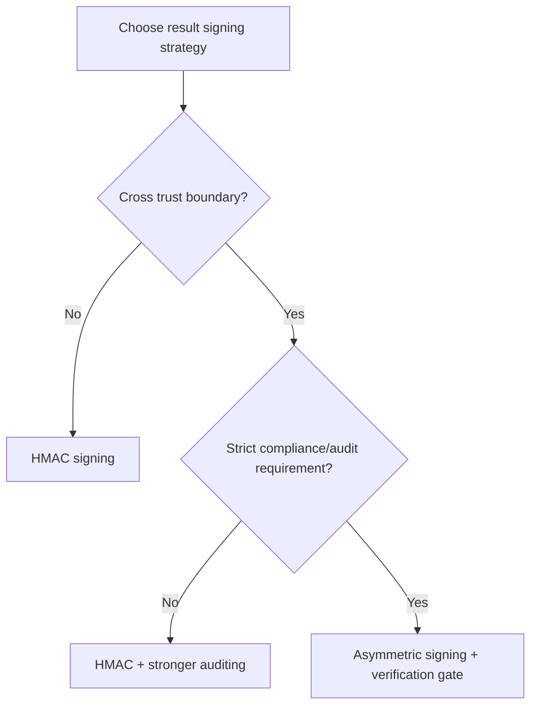
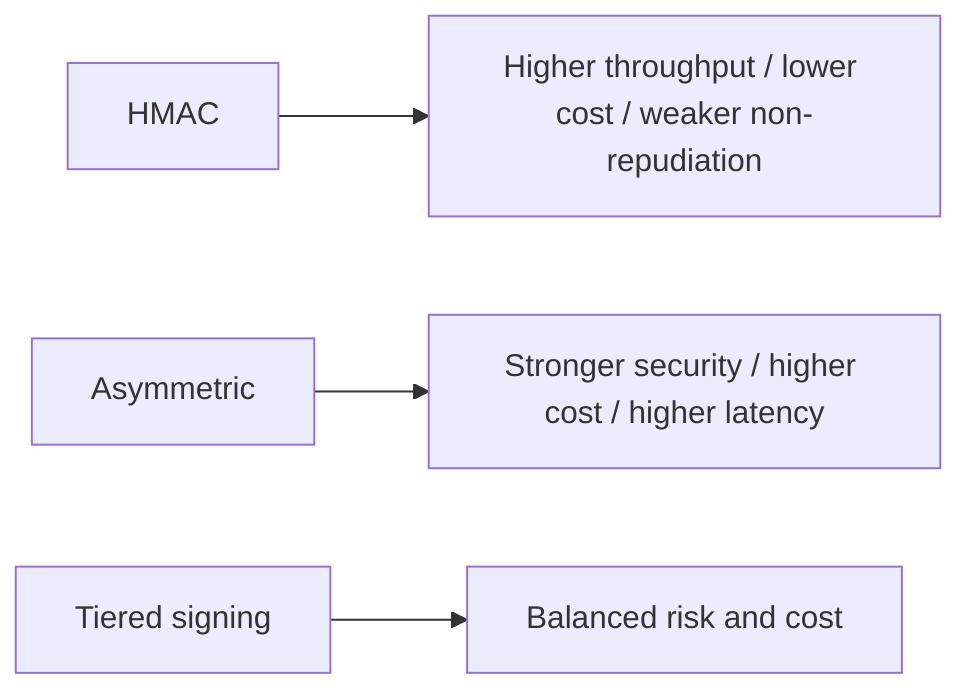
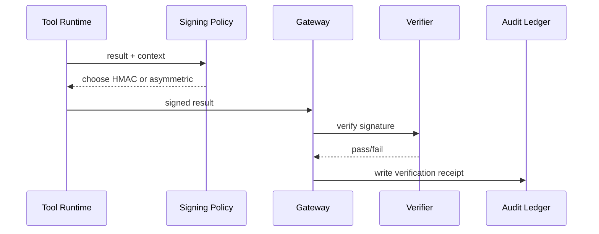

# Agent Tool Result Signing FAQ (HMAC Signing vs Asymmetric Signing)

> Scope lock: this topic focuses only on tool-result integrity/signing strategy in agent workflows, not model selection or identity injection.

## 1) 📌 Core conclusions at a glance (3 points)

1. **HMAC is the default for high-throughput single-boundary lanes**: simple implementation, fast verification, low unit cost.  
2. **Asymmetric signing is preferred for cross-system trust exchange** with stronger non-repudiation and key separation.  
3. **Production baseline should be tiered signing**: HMAC for normal lanes, automatic asymmetric promotion for cross-boundary/high-compliance lanes with audit receipts.  

## 2) 🎯 Q1 / Q2 / Q3 (plain language + first principles)

### Q1: Why sign tool results at all?

- **Plain language**: without signatures, you cannot reliably prove results were not modified in transit.  
- **First principle**: signatures provide verifiable integrity and authenticity, the minimum trust primitive for autonomous chains.  

### Q2: When is HMAC enough, and when is asymmetric required?

- **HMAC enough**: single trust boundary, unified key management, throughput-first constraints;  
- **Asymmetric preferred**: cross-system exchange, third-party audit, non-repudiation requirements;  
- **Hybrid**: HMAC for internal high-rate paths, asymmetric for external/critical evidence paths.  

### Q3: How does tiered result-signing governance work?

- **Plain language**: use fast signing for normal lanes and stronger signing only for high-risk lanes.  
- **First principle**: tier security strength vs performance cost and pay the higher crypto overhead only where risk demands it.  
- **Path**: tool result generated → signing-policy decision → HMAC or asymmetric signature → gateway verification → audit ledger receipt.  

## 3) 🧭 Mermaid views (TD decision tree + LR path + sequence)

## 4) 📊 Architect decision matrix

| Dimension | HMAC signing | Asymmetric signing | Tiered signing (recommended) |
|---|---|---|---|
| Implementation complexity | Low | Medium-High | Medium |
| Throughput performance | High | Medium | High |
| Non-repudiation strength | Low | High | Medium-High |
| Key-governance complexity | Medium | High | Medium |
| Default recommendation | ✅ internal high-rate lanes | ⚠ cross-boundary compliance lanes | ✅ large-scale production |

## 5) 🧪 Quantitative example + 7-card insight

> Source of truth: `evidence/cycle-411-benchmark.json`.  
> Provenance labels: `measured` / `synthetic` / `anonymized_reported`; production paid-run metrics not executed are marked `not_measured`.

| Metric | HMAC baseline | Tiered-signing baseline |
|---|---:|---:|
| Verification latency P95 | 8.1 ms | 13.9 ms |
| Tamper-detection hit rate | 89.6% | 92.2% |
| Throughput retention ratio | 1.00x | 0.93x |
| Ops complexity score (1 low-10 high) | 4.1 | 6.4 |
| Production billing reconciliation | `not_measured` | `not_measured` |

7-card deck: `benchmark-cards.en.html` / `benchmark-cards.html` (4:5, CSP self-contained, coordinates from this cycle's sealed evidence only)

## 6) 🛠️ Production validation checklist

- [ ] Define HMAC/asymmetric switching criteria (boundary/compliance/risk)
- [ ] Configure key rotation and revocation policies
- [ ] Configure fallback and alert paths for verification failures
- [ ] Persist signing and verification receipts into MCP/A2A audit ledger
- [ ] Run periodic tamper-injection replay drills
- [ ] Monitor latency, hit-rate, cost, and failure metrics together
- [ ] Publish evidence bundle (latency/throughput/policy/cost) for each release
