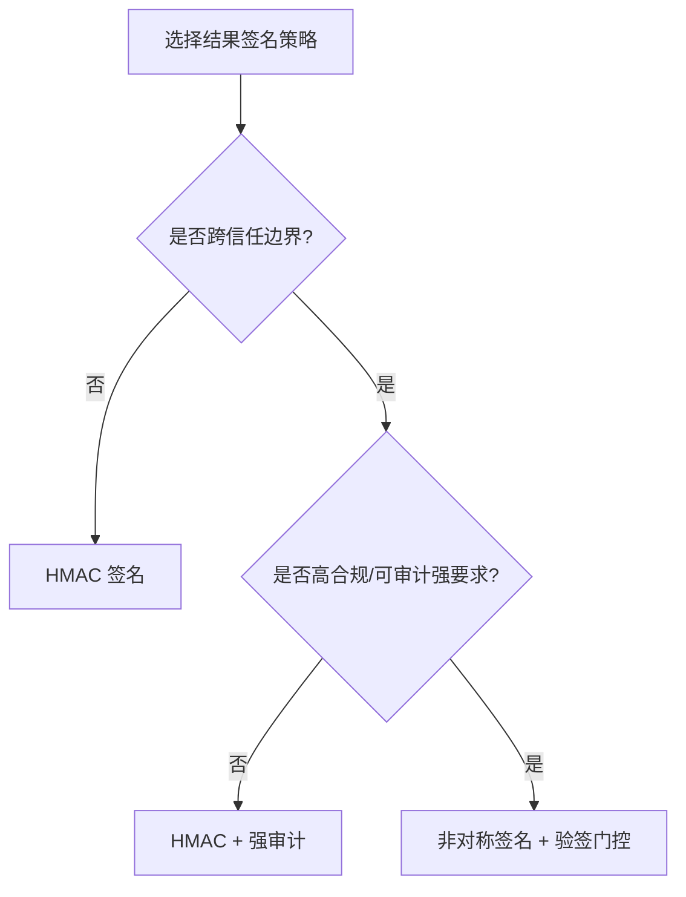
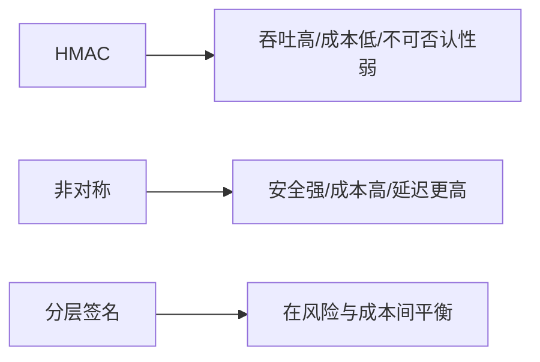
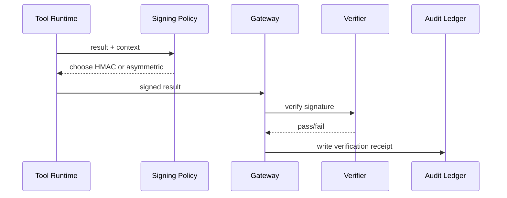

# Agent 工具结果签名策略选型 FAQ（HMAC 签名 vs 非对称签名）

> 专题边界：仅讨论 Agent 工具调用结果的完整性与签名策略，不扩展到模型选型与身份注入。

## 1) 📌 核心结论速览（3 条）

1. **单边界内高吞吐场景优先 HMAC**：实现简单、验证快、单位成本低。  
2. **跨团队/跨系统可信交换优先非对称签名**：具备更强的不可否认性与密钥分离能力。  
3. **生产默认建议分层签名策略**：常态 HMAC，跨域/高合规链路自动升档非对称签名并写审计回执。  

## 2) 🎯 Q1 / Q2 / Q3（大白话 + 第一性原理）

### Q1：为什么要给工具结果做签名？

- **大白话**：不签名就很难证明“这条结果没被中途篡改”。  
- **第一性原理**：签名提供可验证完整性（integrity）与来源证明（authenticity），是自治链路最小可信单元。  

### Q2：什么时候 HMAC 足够？什么时候要非对称签名？

- **HMAC 足够**：服务边界单一、密钥托管统一、吞吐优先；  
- **非对称更优**：跨系统互信、第三方审计、需要不可否认性；  
- **混合策略**：内部高频调用 HMAC，外部交换与关键落账用非对称。  

### Q3：核心机制 X（Tiered Result Signing）怎么工作？

- **大白话**：普通链路用快签名，关键链路自动升级强签名。  
- **第一性原理**：在“安全强度”和“性能成本”之间做风险分层，只在高风险链路支付更高签名代价。  
- **链路**：工具结果生成 → 签名策略判定 → HMAC 或非对称签名 → 网关验签 → 审计账本落证。  

## 3) 🧭 Mermaid（决策树 TD + 路径 LR + 时序）

## 4) 📊 架构师决策矩阵

| 维度 | HMAC 签名 | 非对称签名 | 分层签名（推荐） |
|---|---|---|---|
| 实现复杂度 | 低 | 中-高 | 中 |
| 吞吐性能 | 高 | 中 | 高 |
| 不可否认性 | 低 | 高 | 中-高 |
| 密钥治理复杂度 | 中 | 高 | 中 |
| 默认建议 | ✅ 内部高频调用 | ⚠ 跨域高合规链路 | ✅ 生产大规模场景 |

## 5) 🧪 定量算例 + 7-Card 洞察

> 数据来源：`evidence/cycle-411-benchmark.json`。  
> 标签口径：`measured` / `synthetic` / `anonymized_reported`；生产真实付费实验未执行标 `not_measured`。

| 指标 | HMAC 基线 | 分层签名基线 |
|---|---:|---:|
| 验签 P95 延迟 | 8.1 ms | 13.9 ms |
| 篡改检测命中率 | 89.6% | 92.2% |
| 吞吐保持率 | 1.00x | 0.93x |
| 运维复杂度评分（1低-10高） | 4.1 | 6.4 |
| 生产账单对账 | `not_measured` | `not_measured` |

7-card：`benchmark-cards.html` / `benchmark-cards.en.html`（4:5、自包含 CSP、坐标仅取本轮封存证据）

## 6) 🛠️ 生产核验 Checklist

- [ ] 明确 HMAC 与非对称签名的切换条件（边界/合规/风险）
- [ ] 配置密钥轮换与失效策略
- [ ] 验签失败链路配置回退与告警
- [ ] 结果签名与验签回执写入 MCP/A2A 审计账本
- [ ] 周期回放篡改注入演练
- [ ] 联合监控延迟、命中率、成本与失败率
- [ ] 发布时附证据包（latency/throughput/policy/cost）
