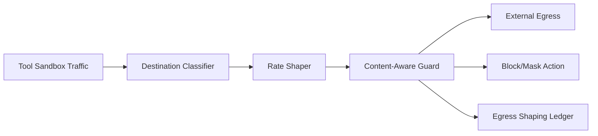

# Agent Tool Sandbox Egress Shaping Selection FAQ (Cycle 1783)

## 1) Three-minute decision
- **The key control point for tool sandboxes is not just whether egress is allowed, but how egress behavior is shaped by policy.**
- **Recommendation:** destination tiering + rate shaping + content-aware blocking.
- **Goal:** preserve tool usability while reducing exfiltration, abuse, and bandwidth contention risks.

## 2) Core questions (Q1/Q2/Q3)
### Q1: Why static allowlists can still fail?
1) risky request patterns can exist under allowed domains,
2) burst concurrency can saturate egress budgets,
3) no semantic inspection misses subtle exfil channels.

### Q2: What is the minimum viable shaping chain?
- destination tiers: core/general/restricted dependencies,
- rate shaping: tenant/tool-bucket limits,
- content-aware guard: block or redact sensitive patterns.

### Q3: How to validate without hurting business paths?
- stable success rate for critical tools,
- bounded egress bandwidth peaks,
- higher sensitive-flow interception with explainable false positives.

## 3) Reference architecture

## 4) Decision matrix
| Dimension | Static allowlist | Tiered shaping + content guard (Recommended) |
|---|---:|---:|
| Security elasticity | Low | High |
| Peak controllability | Low | High |
| Misuse interception | Medium | High |
| Implementation complexity | Low | Medium |
| Audit traceability | Medium | High |

## 5) Evidence and reproducibility
- Evidence files:
  - `workshops/azure-agent-infra/evidence/cycle-1783-benchmark.json`
  - `workshops/azure-agent-infra/evidence/cycle-1783-latency.csv`
  - `workshops/azure-agent-infra/evidence/cycle-1783-throughput.csv`
  - `workshops/azure-agent-infra/evidence/cycle-1783-policy.csv`
- Labels: `measured / synthetic / anonymized_reported`.
- validation7 requires bilingual structure, CSP self-contained cards, evidence consistency, and replayability trace.

## 6) Production checklist
- [ ] Destination-tier rules are auditable.
- [ ] Rate shaping supports tenant/tool buckets.
- [ ] Content-aware block policy supports canary rollback.
- [ ] Allow/block decisions are ledgered.
- [ ] FAQ/H5/SVG/7-card references are cycle-aligned.
