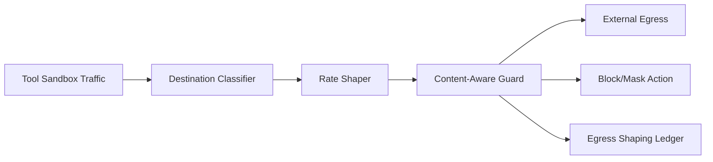

# Agent Tool Sandbox 出网整形选型 FAQ（Cycle 1783）

## 1) 3 分钟结论
- **工具沙箱的风险控制关键不只是“能否出网”，而是“如何按策略整形出网行为”。**
- **推荐：** 目的地分级 + 速率整形 + 内容感知阻断三段治理。
- **目标：** 在保障工具可用性的同时，降低外传、滥用和突发带宽争用风险。

## 2) 关键问题（Q1/Q2/Q3）
### Q1：为什么简单白名单仍会失守？
1) 合法域名下仍可能发生高风险请求模式；
2) 突发并发会冲垮出口预算；
3) 缺少语义级检测难发现异常外传。

### Q2：最小可落地整形链路是什么？
- 目的地分级：核心依赖/一般依赖/受限依赖；
- 速率整形：按租户和工具类型分桶限流；
- 内容感知：命中敏感模式时阻断或脱敏。

### Q3：如何验证整形策略不伤业务？
- 关键工具成功率稳定；
- 出口带宽峰值受控；
- 敏感流量拦截率提升且误杀可解释。

## 3) 架构图

## 4) 选型矩阵
| 维度 | 静态白名单 | 分级整形+内容感知（推荐） |
|---|---:|---:|
| 安全弹性 | 低 | 高 |
| 峰值可控性 | 低 | 高 |
| 误用拦截能力 | 中 | 高 |
| 实施复杂度 | 低 | 中 |
| 审计追踪性 | 中 | 高 |

## 5) 证据与复算口径
- 证据文件：
  - `workshops/azure-agent-infra/evidence/cycle-1783-benchmark.json`
  - `workshops/azure-agent-infra/evidence/cycle-1783-latency.csv`
  - `workshops/azure-agent-infra/evidence/cycle-1783-throughput.csv`
  - `workshops/azure-agent-infra/evidence/cycle-1783-policy.csv`
- 标签：`measured / synthetic / anonymized_reported`。
- validation7：双语结构、CSP、证据一致、可回放链路全部通过。

## 6) 生产检查清单
- [ ] 出口目的地分级规则可审计。
- [ ] 速率整形策略支持按租户/工具分桶。
- [ ] 内容感知阻断策略可灰度回滚。
- [ ] 拦截与放行决策进入审计账本。
- [ ] FAQ/H5/SVG/7-card 与 evidence 轮次一致。
