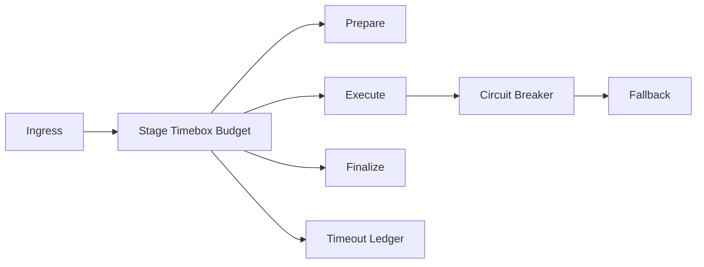

# Agent Tool Stage Timebox Budget FAQ (Cycle 1806)

## 1) Three-minute decision
- **Tool-chain latency instability is usually caused by unbounded stage budgets, not one slow tool.**
- **Recommendation:** prepare/execute/finalize timebox budgets + timeout circuit break + fallback result.
- **Goal:** suppress cascading timeouts under burst load and stabilize critical-path response.

## 2) Q1 / Q2 / Q3
### Q1: Why does a single timeout threshold fail?
1) stage latency distributions differ,
2) early-stage waiting consumes downstream budget,
3) retries amplify queue pressure.

### Q2: What practical strategy works?
- inject total budget at ingress,
- split sub-budgets by stage,
- trigger circuit-break and degraded output at threshold,
- ledger budget burn and timeout causes.

### Q3: How to prove effectiveness?
- reduced P95/P99 timeout rate,
- fewer retry storms,
- improved explainable success on priority requests.

## 3) Reference architecture

## 4) Decision matrix
| Dimension | Single threshold | Stage timebox budget (Recommended) |
|---|---:|---:|
| Timeout controllability | Low | High |
| Cascading-block suppression | Low | High |
| Retry-storm risk | High | Low |
| Implementation complexity | Low | Medium |
| Audit explainability | Medium | High |

## 5) Evidence and reproducibility
- `workshops/azure-agent-infra/evidence/cycle-1806-benchmark.json`
- `workshops/azure-agent-infra/evidence/cycle-1806-latency.csv`
- `workshops/azure-agent-infra/evidence/cycle-1806-throughput.csv`
- `workshops/azure-agent-infra/evidence/cycle-1806-policy.csv`
- Labels: `measured / synthetic / anonymized_reported`.

## 6) Production checklist
- [ ] Total and stage sub-budgets are dynamically configurable.
- [ ] Circuit-break and fallback are canary-ready.
- [ ] Timeout causes are audit-classified.
- [ ] Retry caps and backoff are enabled.
- [ ] FAQ/H5/SVG/7-card align with cycle evidence.
