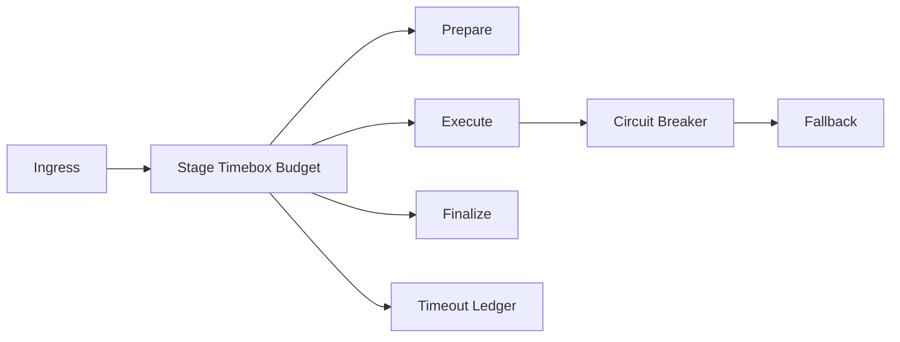

# Agent 工具阶段时箱预算选型 FAQ（Cycle 1806）

## 1) 3 分钟结论
- **工具链时延失稳的根因往往是阶段预算无边界，而不是单个工具慢。**
- **推荐：** 准备/执行/收尾三阶段时箱预算 + 超时熔断 + 回退结果。
- **目标：** 在突发负载下抑制级联超时，保障关键路径响应稳定。

## 2) Q1 / Q2 / Q3
### Q1：为什么统一超时阈值会失效？
1) 各阶段耗时分布差异大；
2) 前序等待会吞噬后序预算；
3) 失败重试会加剧排队。

### Q2：可落地策略是什么？
- 入口注入总预算；
- 按阶段切分子预算；
- 超阈值触发熔断和降级输出；
- 预算消耗与原因写入账本。

### Q3：如何证明有效？
- P95/P99 超时率下降；
- 重试风暴收敛；
- 高优请求成功率提升并可解释。

## 3) 架构图

## 4) 选型矩阵
| 维度 | 统一阈值 | 阶段时箱预算（推荐） |
|---|---:|---:|
| 超时可控性 | 低 | 高 |
| 级联阻塞抑制 | 低 | 高 |
| 重试风暴风险 | 高 | 低 |
| 实施复杂度 | 低 | 中 |
| 审计可解释性 | 中 | 高 |

## 5) 证据与复算口径
- `workshops/azure-agent-infra/evidence/cycle-1806-benchmark.json`
- `workshops/azure-agent-infra/evidence/cycle-1806-latency.csv`
- `workshops/azure-agent-infra/evidence/cycle-1806-throughput.csv`
- `workshops/azure-agent-infra/evidence/cycle-1806-policy.csv`
- 标签：`measured / synthetic / anonymized_reported`。

## 6) 生产检查清单
- [ ] 总预算与阶段子预算可动态下发。
- [ ] 熔断和回退策略可灰度。
- [ ] 超时原因分类可审计。
- [ ] 重试上限与退避策略生效。
- [ ] FAQ/H5/SVG/7-card 与 evidence 轮次一致。
