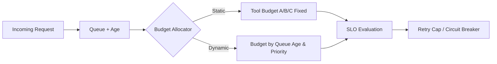

# Agent Tool Timeout Budget Allocation FAQ (Static Split vs Queue-Age Dynamic Split)

> **Relation to Round20**: Round20 chose layered timeout budgets over a single global timeout. This round is the child decision: once layered budgets exist, should tool-level budget allocation be static or queue-age dynamic?

## 1) Core conclusions
- **Queue-age dynamic allocation is the production default for bursty multi-tenant workloads**.
- **Static budget splits are acceptable for stable low-variance pipelines only**.
- **Timeout governance must be coupled to retry caps, backpressure, and circuit breakers**, otherwise failures are merely deferred.

## 2) Q1 / Q2 / Q3 (plain terms first)
- **Static split**: each tool always gets a fixed share (e.g., 40%/30%/30%).
- **Queue-age dynamic split**: older requests or higher-priority requests get adaptive budget or earlier fallback.

### Q1: Why can fixed total budget still fail?
First principle: with queue jitter, low-value slow calls can consume budget and starve critical-path calls.

### Q2: When is static allocation enough?
When chain depth and traffic variance are both low, and latency distributions are narrow.

### Q3: What is the minimum viable dynamic-allocation loop?
Queue age signal + priority policy + fallback action, with allocation traces persisted for audit.

## 3) Mermaid (allocation control loop)

## 4) Decision matrix (scope of this round)
| Dimension | Static split | Queue-age dynamic split |
|---|---|---|
| Configuration complexity | Low | Medium-High |
| Tail-latency resilience | Low | High |
| Critical-path protection | Medium | High |
| Audit explainability | Medium | High (with allocation traces) |
| Default fit | Stable low-variance workloads | Bursty multi-tenant workloads |

## 5) Evidence contract + recomputable example (with n/denominator/source)
> Percentages in this section are **synthetic_assumed**; production validation remains **not_measured**.  
> Field contract path: `workshops/azure-agent-infra/evidence/cycle-417-benchmark.json` -> `percentage_contract`.

- Metric A (timeout rate under static split)  
  - Formula: `n_timeout_static / n_requests`  
  - Assumed values: `273/3000 = 9.1%`  
  - Path: `percentage_contract.static_allocation_timeout_rate`
- Metric B (timeout rate under dynamic split)  
  - Formula: `n_timeout_dynamic / n_requests`  
  - Assumed values: `120/3000 = 4.0%`  
  - Path: `percentage_contract.dynamic_allocation_timeout_rate`
- Metric C (success gain of dynamic over static)  
  - Formula: `(n_success_dynamic - n_success_static) / n_requests`  
  - Assumed values: `(2880-2727)/3000 = 5.1%`  
  - Path: `percentage_contract.dynamic_vs_static_success_gain`

## 6) Production checklist
- [ ] Tool budget strategy has explicit versioning and rollback target  
- [ ] Queue age is observable and attached to traces  
- [ ] Retry caps are validated together with breaker thresholds  
- [ ] This round is tagged `synthetic_assumed`; production status is `not_measured`  
