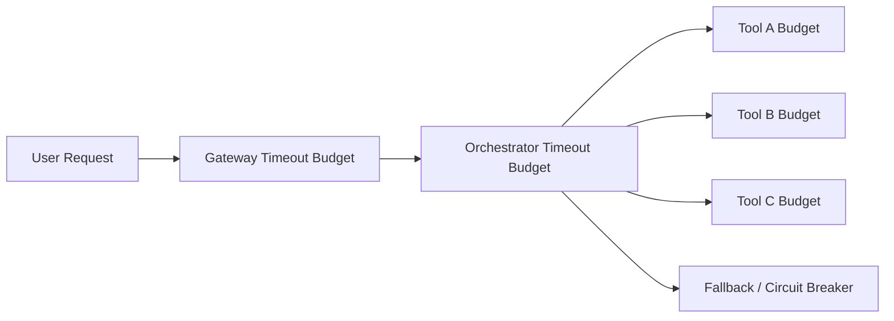

# Agent Tool Timeout Budget Selection FAQ (Global Timeout vs Layered Budgets)

## 0) Executive takeaway
- **Default to layered timeout budgets in production** (gateway/orchestrator/tool levels).
- **A single global timeout is only for simple flows** and can amplify tail latency and retry storms.
- **At scale, timeout budgets must be linked to circuit-breaking, retry caps, and backpressure**.

## 1) What are you choosing?
- Global timeout: simple config, poor per-hop control.
- Layered budgets: more governance, better deterministic behavior.

## 2) When global timeout is acceptable
- single-tool short pipeline
- narrow latency distribution
- acceptable failure impact

## 3) When layered budgets are mandatory
- multi-hop A2A + MCP chains
- mixed browser/CUA and coding workloads
- regulated workloads requiring deterministic fallback

## 4) Architecture sketch

## 5) Decision matrix
| Dimension | Global timeout | Layered budgets |
|---|---|---|
| Config complexity | Low | Medium |
| Tail-latency control | Weak | Strong |
| Fault isolation | Weak | Strong |
| Auditability | Medium | High |
| Long-term stability | Medium | High |

## 6) Recomputable example
Assume a 3-hop chain with 3000ms total budget:
- Global timeout: any slow hop can consume the full budget, success=91%
- Layered budgets: gateway400 + orchestrator600 + tools(1200/500/300), success=96%

Under this assumption, layered budgets improve success by **5 percentage points**.
