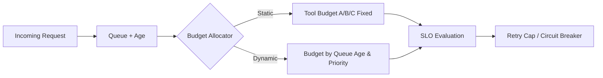

# Agent 工具超时预算分配选型 FAQ（静态配比 vs 队列年龄动态配比）

> **与 Round20 的关系**：Round20 决策“全局超时 vs 分层预算”；本轮是其子题——分层预算已确定后，工具层预算如何分配（静态配比 vs 动态配比）。

## 1) 核心结论（先给值班架构师）
- **高并发生产默认选“队列年龄动态配比”**，可显著降低尾延迟挤压。
- **静态配比适合低波动链路**，但在突发峰值时容易让关键调用饥饿。
- **预算策略必须和重试上限、队列背压、熔断门槛联动**，否则只会把失败后移。

## 2) Q1 / Q2 / Q3（术语先通俗解释）
- **静态配比**：每个工具固定拿到 40%/30%/30% 超时预算。
- **队列年龄动态配比**：排队越久的请求，优先获得更多预算或更快回退。

### Q1：为什么“总预算固定”仍会失败？
第一性原理：同样的总预算，在排队抖动下会被低价值慢调用抢占，关键路径超时概率上升。

### Q2：静态配比什么时候够用？
调用链长度稳定、流量波动小、工具时延分布窄时，静态配比有更低治理成本。

### Q3：动态配比的最小实现要求？
必须有“队列年龄信号 + 优先级策略 + 回退动作”，并把预算变化写入审计字段。

## 3) Mermaid（预算分配闭环）

## 4) 决策矩阵（本轮子题边界）
| 维度 | 静态配比 | 队列年龄动态配比 |
|---|---|---|
| 配置复杂度 | 低 | 中-高 |
| 尾延迟抗抖动 | 低 | 高 |
| 关键路径保障 | 中 | 高 |
| 审计可解释性 | 中 | 高（需记录预算轨迹） |
| 适用默认 | 低波动业务 | 多租户高并发业务 |

## 5) 数据证据与可复算算例（含 n/分母/来源）
> 本节百分比均为 **synthetic_assumed**；生产真实超时链路验证为 **not_measured**。  
> 合同字段见：`workshops/azure-agent-infra/evidence/cycle-417-benchmark.json` 的 `percentage_contract`。

- 指标 A（静态配比超时率）  
  - 定义：`n_timeout_static / n_requests`  
  - 假设：`273/3000 = 9.1%`  
  - 路径：`percentage_contract.static_allocation_timeout_rate`
- 指标 B（动态配比超时率）  
  - 定义：`n_timeout_dynamic / n_requests`  
  - 假设：`120/3000 = 4.0%`  
  - 路径：`percentage_contract.dynamic_allocation_timeout_rate`
- 指标 C（成功率提升）  
  - 定义：`(n_success_dynamic - n_success_static) / n_requests`  
  - 假设：`(2880-2727)/3000 = 5.1%`  
  - 路径：`percentage_contract.dynamic_vs_static_success_gain`

## 6) 生产 Checklist（可上线前置）
- [ ] 工具预算策略有版本号与回滚版本  
- [ ] 请求队列年龄可观测且写入 trace 标签  
- [ ] 重试上限与熔断门槛联动验证完成  
- [ ] 本轮数据标记 `synthetic_assumed`，生产状态 `not_measured`  
