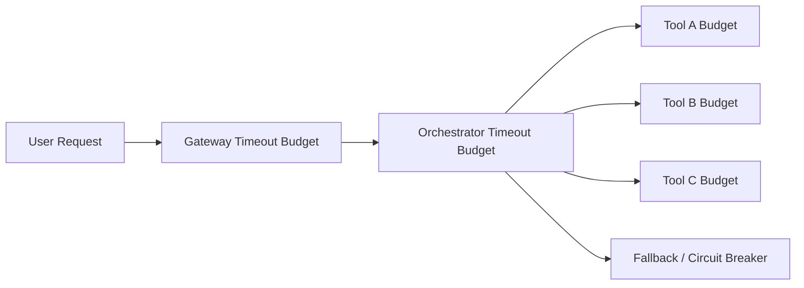

# Agent 工具超时预算选型 FAQ（统一全局超时 vs 分层超时预算）

## 0) 一句话结论
- **生产默认选分层超时预算**（网关/编排/工具三级），比全局单阈值更稳。
- **统一全局超时只适合简单链路**，在多工具编排下会放大尾延迟与重试风暴。
- **高并发场景要把超时预算和熔断、重试次数、队列背压联动**。

## 1) 你在选什么
- 全局超时：配置简单，但无法区分慢工具与关键路径。
- 分层预算：治理更复杂，但能精准控制每跳耗时与回退策略。

## 2) 全局超时适用场景
- 单工具、短链路
- 延迟分布窄
- 故障后果可接受

## 3) 必须分层预算的场景
- A2A + MCP 多跳工具链
- 浏览器/CUA任务与代码执行混合
- 金融/合规场景需要确定性回退

## 4) Mermaid

## 5) 决策矩阵
| 维度 | 全局超时 | 分层预算 |
|---|---|---|
| 配置复杂度 | 低 | 中 |
| 尾延迟控制 | 弱 | 强 |
| 故障隔离 | 弱 | 强 |
| 可审计性 | 中 | 高 |
| 长期稳定性 | 中 | 高 |

## 6) 可复算算例
假设 3 跳链路，预算总额 3000ms：
- 全局超时：任一慢跳可能占满预算，成功率 91%
- 分层预算：网关400 + 编排600 + 工具(1200/500/300)，成功率 96%

在该假设下，分层预算提升成功率 **5 个百分点**。
