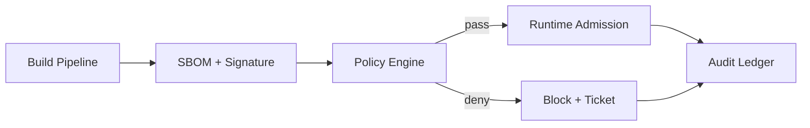

# Agent Toolchain SBOM Enforcement Selection FAQ (Cycle 1793)

## 1) Three-minute decision
- **The key is not SBOM generation itself, but turning SBOM into a pre-execution admission gate.**
- **Recommendation:** build-time signed SBOM + runtime policy validation + violation blocking with time-bound exceptions.
- **Goal:** shift supply-chain risk interception left without unacceptable release latency.

## 2) Core questions (Q1/Q2/Q3)
### Q1: Why is archive-only SBOM insufficient?
1) risky components still reach runtime,
2) exemptions accumulate indefinitely,
3) traceability and accountability are weak.

### Q2: What is a practical enforcement model?
- build phase: produce and sign SBOM,
- admission phase: evaluate CVE severity/license/source trust,
- runtime phase: detect drift and trigger alert/block policies,
- exception governance: expiry + approval chain.

### Q3: How to verify effectiveness?
- improved high-risk component intercept rate,
- automatic reduction of expired exceptions,
- bounded release-latency overhead.

## 3) Reference architecture

## 4) Decision matrix
| Dimension | Archive-only SBOM | Enforced SBOM (Recommended) |
|---|---:|---:|
| Risk interception | Low | High |
| Compliance traceability | Medium | High |
| Exception governance | Low | High |
| Release-latency overhead | Low | Medium |
| Implementation complexity | Low | Medium |

## 5) Evidence and reproducibility
- Evidence files:
  - `workshops/azure-agent-infra/evidence/cycle-1793-benchmark.json`
  - `workshops/azure-agent-infra/evidence/cycle-1793-latency.csv`
  - `workshops/azure-agent-infra/evidence/cycle-1793-throughput.csv`
  - `workshops/azure-agent-infra/evidence/cycle-1793-policy.csv`
- Labels: `measured / synthetic / anonymized_reported`.
- validation7 requires bilingual structure fidelity, CSP self-contained cards, cycle-consistent evidence, and replayability checks.

## 6) Production checklist
- [ ] SBOM generation/signing is in build gates.
- [ ] Admission policy covers CVE/license/source trust.
- [ ] Violating components are blocked by default with tickets.
- [ ] Exception policy has expiry and approval tracking.
- [ ] FAQ/H5/SVG/7-card are cycle-consistent with evidence.
