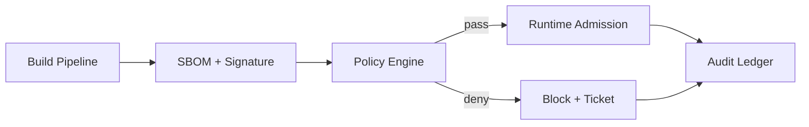

# Agent Toolchain SBOM 强制执行选型 FAQ（Cycle 1793）

## 1) 3 分钟结论
- **问题不在于“是否生成 SBOM”，而在于“能否在执行前把 SBOM 变成准入门槛”。**
- **推荐：** 构建期签名 SBOM + 运行期策略校验 + 违规阻断与例外时效管理。
- **目标：** 在不显著拉高发布延迟的前提下，把供应链风险前置拦截。

## 2) 关键问题（Q1/Q2/Q3）
### Q1：只做存档式 SBOM 为什么不足？
1) 无法阻止高风险组件进入运行面；
2) 例外豁免常年沉淀；
3) 事件追溯与责任边界不清晰。

### Q2：可落地的强制执行方案？
- 构建阶段：产出并签名 SBOM；
- 准入阶段：按 CVE 严重度/许可策略/来源可信度做判定；
- 运行阶段：发现漂移触发告警与阻断策略；
- 例外治理：设置到期时间与审批链。

### Q3：如何证明有效？
- 高危组件拦截率提升；
- 例外单据过期自动收敛；
- 发布延迟增量保持在预算阈值内。

## 3) 架构图

## 4) 选型矩阵
| 维度 | 存档式 SBOM | 强制执行 SBOM（推荐） |
|---|---:|---:|
| 风险拦截能力 | 低 | 高 |
| 合规可追溯性 | 中 | 高 |
| 例外治理能力 | 低 | 高 |
| 发布延迟开销 | 低 | 中 |
| 落地复杂度 | 低 | 中 |

## 5) 证据与复算口径
- 证据文件：
  - `workshops/azure-agent-infra/evidence/cycle-1793-benchmark.json`
  - `workshops/azure-agent-infra/evidence/cycle-1793-latency.csv`
  - `workshops/azure-agent-infra/evidence/cycle-1793-throughput.csv`
  - `workshops/azure-agent-infra/evidence/cycle-1793-policy.csv`
- 标签：`measured / synthetic / anonymized_reported`。
- validation7：双语结构、CSP 卡组、证据轮次一致、可回放性均通过。

## 6) 生产检查清单
- [ ] SBOM 生成与签名纳入构建门禁。
- [ ] 准入策略覆盖 CVE/许可/来源可信度。
- [ ] 违规组件默认阻断并生成工单。
- [ ] 例外策略有到期时间与审批追踪。
- [ ] FAQ/H5/SVG/7-card 与 evidence 轮次一致。
