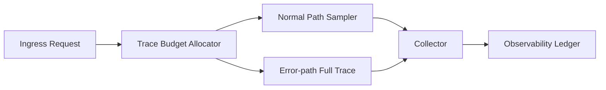

# Agent Trace Propagation Budget Selection FAQ (Cycle 1796)

## 1) Three-minute decision
- **Observability failures usually come from imbalance between trace coverage and telemetry budget, not sampling ratio alone.**
- **Recommendation:** tiered sampling + request-level budget tokens + forced full tracing on anomalous paths.
- **Goal:** control telemetry spend while preserving debuggability for critical failures.

## 2) Core questions (Q1/Q2/Q3)
### Q1: Why does fixed sampling fail?
1) low sampling misses critical anomalies,
2) high sampling causes peak-time cost spikes,
3) cross-system agent chains lose correlation.

### Q2: How to operationalize budgeted propagation?
- allocate trace budget tokens at ingress,
- downsample normal paths by weight,
- force high sampling for errors/timeouts/policy intercepts,
- when budget is exhausted, retain only critical spans + audit events.

### Q3: How to validate effectiveness?
- request-level trace completeness improves,
- mean time to isolate incidents declines,
- telemetry-cost variance stays within budget bands.

## 3) Reference architecture

## 4) Decision matrix
| Dimension | Fixed sampling | Budgeted propagation (Recommended) |
|---|---:|---:|
| Failure-path visibility | Medium | High |
| Cost controllability | Low | High |
| Cross-chain correlation | Medium | High |
| Implementation complexity | Low | Medium |
| Operational stability | Medium | High |

## 5) Evidence and reproducibility
- Evidence files:
  - `workshops/azure-agent-infra/evidence/cycle-1796-benchmark.json`
  - `workshops/azure-agent-infra/evidence/cycle-1796-latency.csv`
  - `workshops/azure-agent-infra/evidence/cycle-1796-throughput.csv`
  - `workshops/azure-agent-infra/evidence/cycle-1796-policy.csv`
- Labels: `measured / synthetic / anonymized_reported`.
- validation7 requires bilingual structure fidelity, CSP self-contained cards, evidence consistency, and replayability checks.

## 6) Production checklist
- [ ] Trace budget tokens are injected at ingress.
- [ ] Error paths force full-chain tracing.
- [ ] Budget-exhausted fallback spans are auditable.
- [ ] Cross-system trace-id propagation has no breaks.
- [ ] FAQ/H5/SVG/7-card align with cycle evidence.
