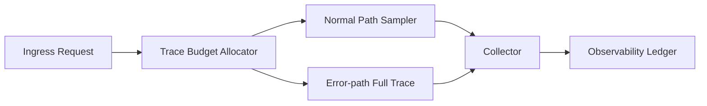

# Agent Trace 传播预算选型 FAQ（Cycle 1796）

## 1) 3 分钟结论
- **可观测性问题常见于“追踪覆盖率”与“成本预算”失衡，而不是单纯采样率高低。**
- **推荐：** 分层采样 + 请求级预算令牌 + 异常路径强制全链路追踪。
- **目标：** 在控制遥测成本的同时，确保关键故障路径可定位可复现。

## 2) 关键问题（Q1/Q2/Q3）
### Q1：为什么固定采样率会失效？
1) 低采样漏掉关键异常；
2) 高采样在峰值时成本失控；
3) 多 Agent 链路跨系统关联断裂。

### Q2：预算化传播如何落地？
- 入口分配 trace budget token；
- 正常路径按权重降采样；
- 错误/超时/策略拦截路径强制提采样；
- 预算耗尽后仅保留关键 span 与审计事件。

### Q3：如何证明策略有效？
- 单请求 trace 完整率提升；
- 故障定位平均时间下降；
- 遥测成本波动进入预算带。

## 3) 架构图

## 4) 选型矩阵
| 维度 | 固定采样 | 预算化传播（推荐） |
|---|---:|---:|
| 故障路径可见性 | 中 | 高 |
| 成本可控性 | 低 | 高 |
| 跨链路关联性 | 中 | 高 |
| 实施复杂度 | 低 | 中 |
| 运维稳定性 | 中 | 高 |

## 5) 证据与复算口径
- 证据文件：
  - `workshops/azure-agent-infra/evidence/cycle-1796-benchmark.json`
  - `workshops/azure-agent-infra/evidence/cycle-1796-latency.csv`
  - `workshops/azure-agent-infra/evidence/cycle-1796-throughput.csv`
  - `workshops/azure-agent-infra/evidence/cycle-1796-policy.csv`
- 标签：`measured / synthetic / anonymized_reported`。
- validation7：双语结构、CSP 自包含、证据一致与回放检查通过。

## 6) 生产检查清单
- [ ] trace budget token 已在入口注入。
- [ ] 异常路径强制全链路追踪已启用。
- [ ] 预算耗尽后的保底 span 策略可审计。
- [ ] 跨系统 trace-id 传播无断链。
- [ ] FAQ/H5/SVG/7-card 与 evidence 轮次一致。
