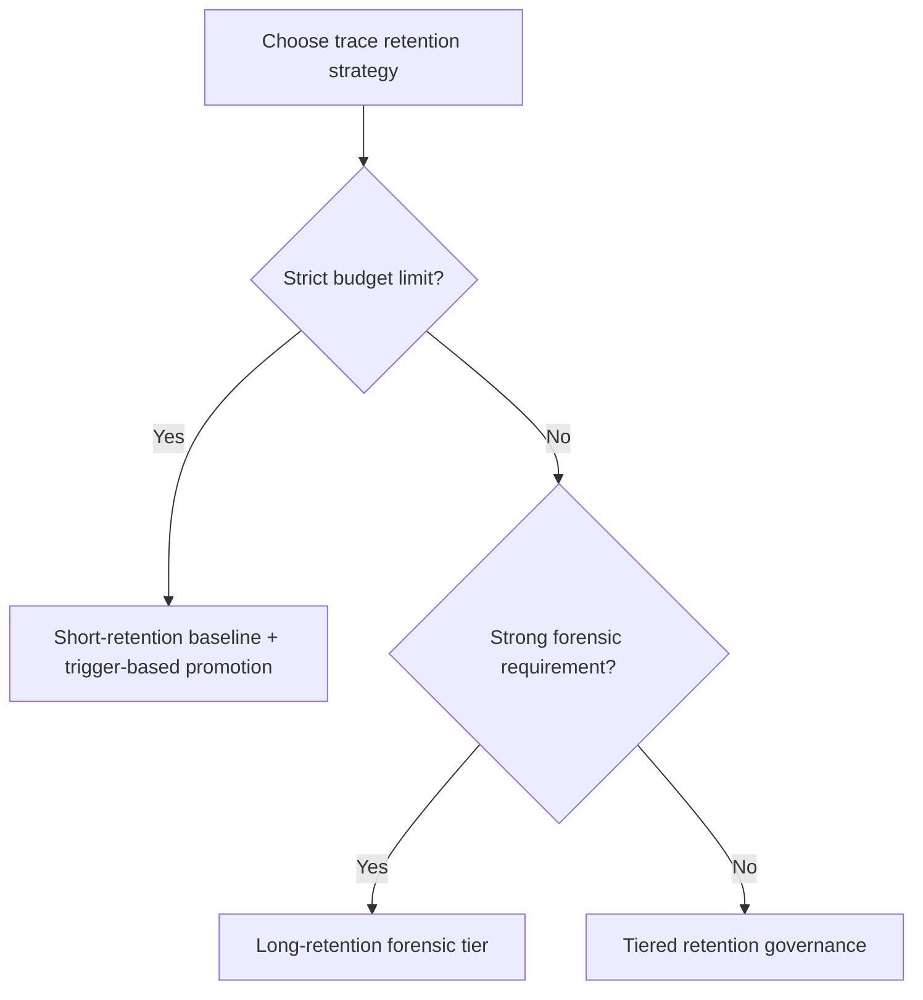
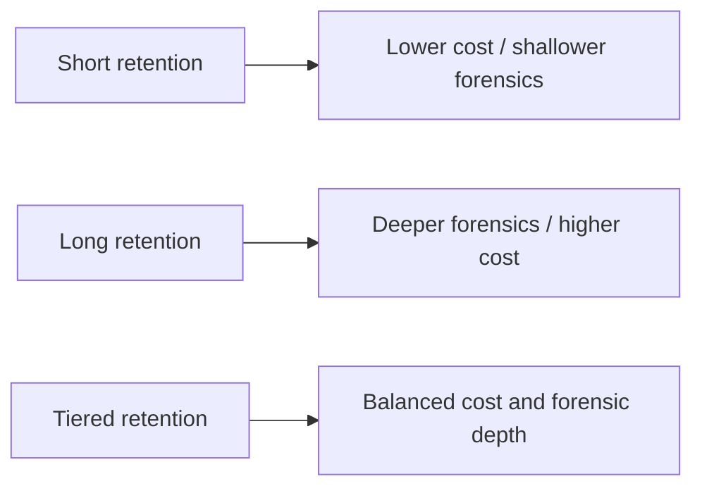
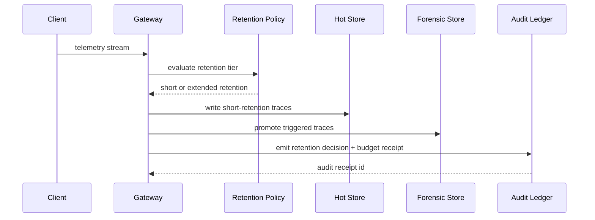

# Agent Trace Retention Window FAQ (Short-Retention Cost Control vs Long-Retention Forensics)

> Scope lock: this cycle focuses only on **agent trace/log retention strategy**. It does not expand into identity injection, model routing, or supply-chain topics.

## 1) 📌 Core conclusions at a glance (3 points)

1. **Default to tiered retention in production**: short-retention for normal traffic, automatic promotion to long-retention for incident signals.  
2. **Always-on long-retention is not the default answer**: it improves forensic completeness but quickly inflates indexing, storage, and query costs.  
3. **Retention policy must launch with budget fences and audit receipts**; otherwise you only move from “invisible incidents” to “visible but unaffordable incidents.”  

## 2) 🎯 Q1 / Q2 / Q3 (plain language + first principles)

### Q1: Why not keep everything for a long time?

- **Plain language**: if you keep all traces for too long, the platform gets heavy and incident search becomes slower.  
- **First principle**: observability cost scales as ingest volume × retention window × indexing complexity. Multiplicative growth hurts quickly.  
- **Symptoms**: hot-storage cost climb, worse query P95, replay backlog congestion.  

### Q2: When is long-retention mandatory?

- Explicit regulatory or compliance retention requirements;  
- Major incident forensics requiring cross-tenant, cross-path timeline evidence;  
- High-value transaction flows needing accountable evidence chains.  

### Q3: How does tiered retention governance work?

- **Plain language**: keep most traffic short-lived, but elevate triggered traces into long-retention automatically.  
- **First principle**: split “global visibility” into “cheap normal-state coverage + deep incident-state capture.”  
- **Path**: ingress classification → short-retention hot tier → trigger policy (error/latency/SLO) → forensic tier → budget fence + audit ledger entry.  

## 3) 🧭 Mermaid views (TD decision tree + LR path + sequence)

## 4) 📊 Architect decision matrix

| Dimension | Short retention | Long retention | Tiered retention (recommended) |
|---|---|---|---|
| Cost control | High | Low | High |
| Forensic completeness | Medium | High | Medium-high |
| Query performance stability | High | Medium-low | High |
| Ops complexity | Low | Medium | Medium |
| Production default | ✅ normal traffic | ⚠ only strict compliance flows | ✅ multi-tenant scale |

## 5) 🧪 Quantitative example + 7-card insight

> Source of truth: `evidence/cycle-407-benchmark.json`.  
> Provenance labels: `measured` / `synthetic` / `anonymized_reported`; production-paid runs not executed are marked `not_measured`.

| Metric | Short-retention baseline | Tiered-retention baseline |
|---|---:|---:|
| Hot-tier storage cost index | 1.0x | 1.3x |
| Long-retention trigger hit rate | 89.4% | 97.0% |
| Budget fence interception rate | 91.6% | 92.2% |
| Query P95 stability score | 90.1 | 94.3 |
| Production billing reconciliation | `not_measured` | `not_measured` |

7-card deck: `benchmark-cards.en.html` / `benchmark-cards.html` (4:5, CSP self-contained, coordinates from this cycle's sealed evidence only)

## 6) 🛠️ Production validation checklist

- [ ] Define short/long retention windows by tenant tier
- [ ] Define promotion triggers (error rate, latency, SLO breach)
- [ ] Configure budget fences and automatic backpressure policy
- [ ] Persist retention decisions into MCP/A2A audit ledger
- [ ] Run periodic replay drills for forensic chain completeness
- [ ] Monitor query performance and cost metrics together
- [ ] Publish evidence bundle (latency/throughput/policy/cost) for each release

