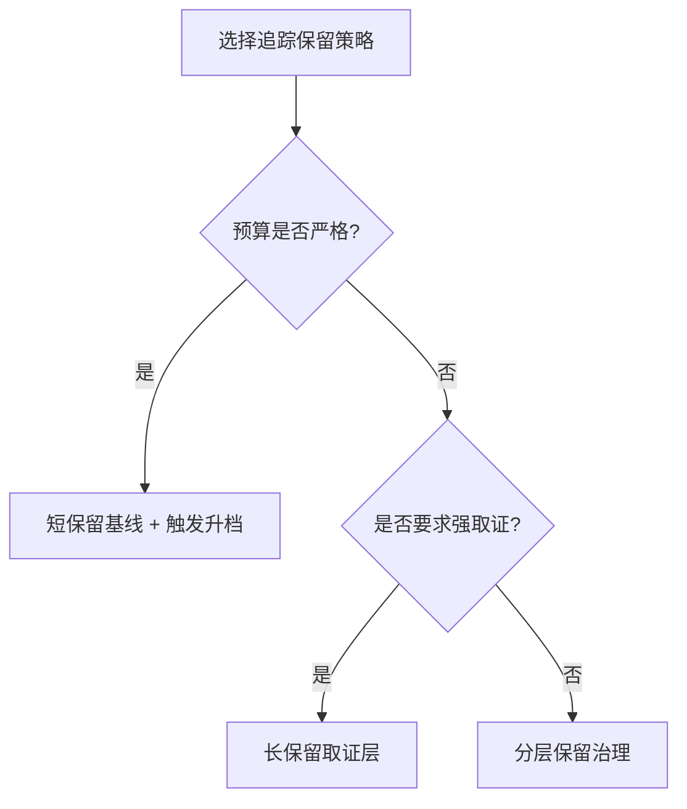
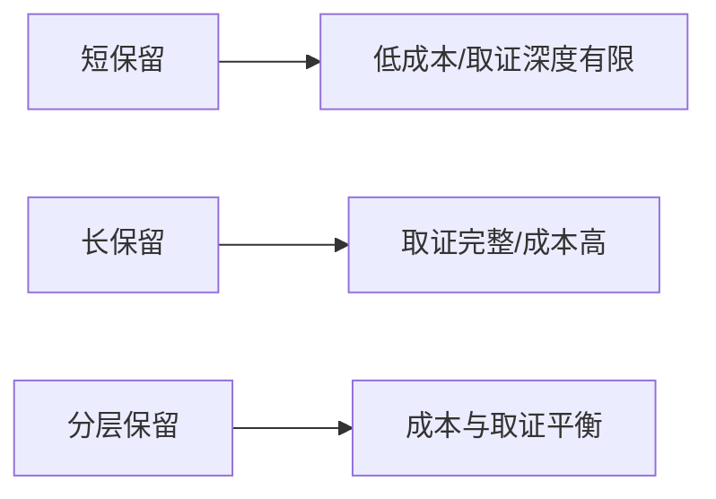
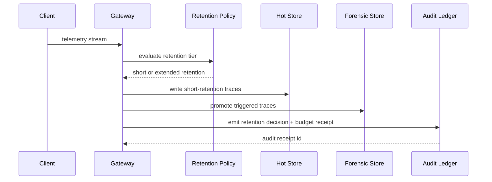

# Agent 追踪保留窗口选型 FAQ（短保留低成本 vs 长保留可取证）

> 专题边界：仅讨论 **Agent Trace/Log 保留窗口策略**，不扩展到身份注入、模型路由或供应链议题。

## 1) 📌 核心结论速览（3 条）

1. **生产默认建议“分层保留窗口”**：常态短保留控成本，异常触发后自动升档到长保留取证。  
2. **全量长保留不是默认答案**：它确实提升取证完整性，但会快速推高索引、存储和查询成本。  
3. **保留策略必须和预算围栏、审计回执一起上线**，否则只会把问题从“看不见”变成“看得见但付不起”。  

## 2) 🎯 Q1 / Q2 / Q3（大白话 + 第一性原理）

### Q1：为什么不能统一长保留？

- **大白话**：全量留太久，平台会越来越“重”，最后连查一条关键问题都变慢。  
- **第一性原理**：可观测系统总成本≈写入体量 × 保留时长 × 索引复杂度；三者叠乘会放大。  
- **表现**：热存储成本爬升、查询 P95 变差、批量回放任务拥塞。  

### Q2：什么时候必须延长保留？

- 监管或审计要求明确保留窗口；  
- 重大事故复盘需要跨租户、跨链路时序证据；  
- 高价值交易或关键业务流程需要“可追责”证据链。  

### Q3：核心机制 X（Tiered Retention Governance）怎么工作？

- **大白话**：先把大多数流量放短保留，只有触发异常规则的流量才进长保留。  
- **第一性原理**：把“全量可见”拆成“常态可控 + 异常可追”，避免为低价值常态数据长期买单。  
- **链路**：入口分类 → 短保留层（hot）→ 触发器（error/latency/SLO）→ 长保留层（forensic）→ 预算围栏与审计落账。  

## 3) 🧭 Mermaid 可视化（决策树 TD + 路径 LR + 时序）

## 4) 📊 架构师决策矩阵

| 维度 | 短保留策略 | 长保留策略 | 分层保留策略（推荐） |
|---|---|---|---|
| 成本可控性 | 高 | 低 | 高 |
| 取证完整性 | 中 | 高 | 中-高 |
| 查询性能稳定性 | 高 | 中-低 | 高 |
| 运营复杂度 | 低 | 中 | 中 |
| 生产默认建议 | ✅ 常态流量 | ⚠ 仅高合规关键链路 | ✅ 多租户规模化 |

## 5) 🧪 定量算例 + 7-Card 洞察

> 数据来源：`evidence/cycle-407-benchmark.json`。  
> 标签口径：`measured` / `synthetic` / `anonymized_reported`；未跑生产付费实验标 `not_measured`。

| 指标 | 短保留基线 | 分层保留基线 |
|---|---:|---:|
| 热层存储成本指数 | 1.0x | 1.3x |
| 长保留触发命中率 | 89.4% | 97.0% |
| 预算围栏拦截率 | 91.6% | 92.2% |
| 查询 P95 稳定性评分 | 90.1 | 94.3 |
| 生产真实账单对账 | `not_measured` | `not_measured` |

7-Card：`benchmark-cards.html` / `benchmark-cards.en.html`（4:5、自包含 CSP、坐标仅取本轮封存证据）

## 6) 🛠️ 生产核验 Checklist

- [ ] 定义短保留/长保留分层窗口（按租户级别）
- [ ] 明确触发升档规则（错误率、延迟、SLO 违约）
- [ ] 配置预算围栏与自动回压策略
- [ ] 保留决策写入 MCP/A2A 审计账本
- [ ] 周期抽样回放验证取证链完整性
- [ ] 查询性能与成本指标并行监控
- [ ] 发布时绑定证据包（latency/throughput/policy/cost）

