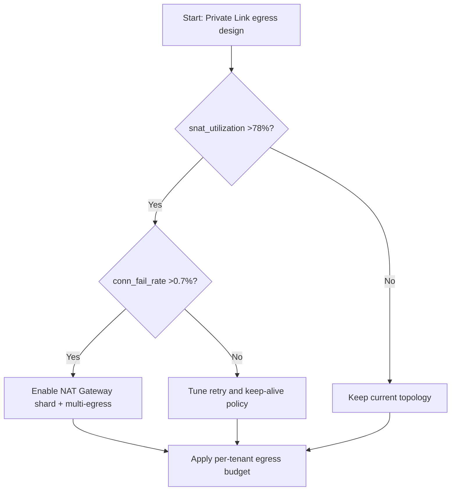
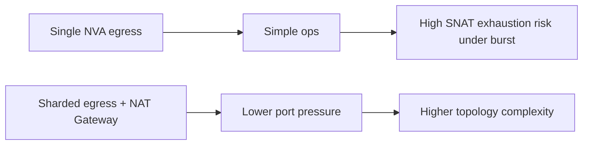
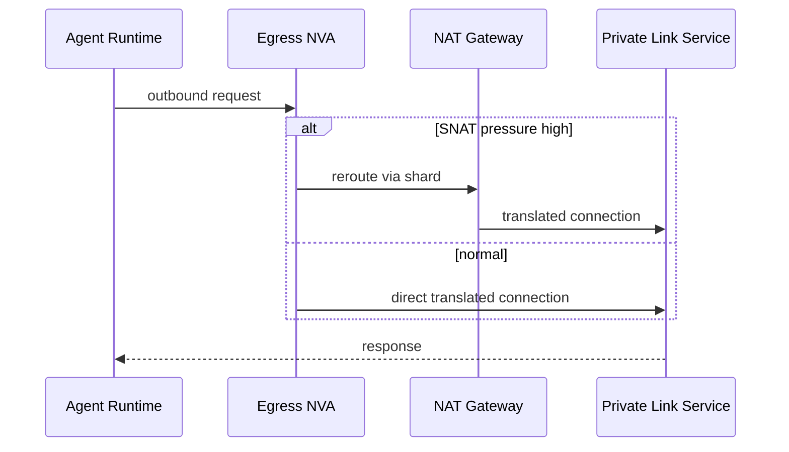

# Agent Private Link + VNet NVA SNAT Port Exhaustion Guard Selection FAQ (Azure AI Agent Infra)

## 1) 3-minute conclusions
- **If NVA SNAT utilization stays above 78% and connection failure exceeds 0.7%, move to sharded egress with NAT Gateway offload** instead of scaling a single egress path.
- **In high-concurrency Private Link workloads, reduce short-connection churn first (pool reuse + keep-alive) before bandwidth scaling**.
- **Production threshold: when available SNAT budget per instance is below 15k and new connection rate exceeds 2.8k/s, SNAT governance is mandatory.**

## 2) Q1 / Q2 / Q3
- **Why do we time out even with enough bandwidth?** The bottleneck is SNAT ports, not raw throughput.
- **Why does Private Link amplify it?** Dense east-west calls, short-lived sessions, and retry amplification.
- **Minimum viable remediations?** Port budget model, connection reuse policy, sharded egress topology, failure circuit breakers.

### Q1: When is NAT Gateway sharding mandatory?
When `snat_utilization > 78%` and `conn_fail_rate > 0.7%` across two consecutive 5-minute windows.

### Q2: When should app-layer fixes come first?
When most `new_conn_rate` comes from short-connection churn rather than true demand growth.

### Q3: How to quantify payoff?
Compare failed-connection reduction per hour versus incremental network cost.

## 3) Mermaid diagrams
### 3.1 Decision tree

### 3.2 Path comparison

### 3.3 Sequence

## 4) Decision matrix
| Dimension | Single NVA egress | Sharded egress + NAT Gateway (Recommended) |
|---|---:|---:|
| Connection failure rate | 0.6%–2.4% | 0.1%–0.6% |
| Connection setup latency P95 | 180–420ms | 95–210ms |
| Peak SNAT utilization | 75%–96% | 42%–71% |
| Ops complexity (1-10) | 5 | 8 |
| Cost | Low to medium | Medium |
| Scalability | Medium | High |

## 5) Quant model + 7-card insights
- Port pressure: `PortPressure = ActiveConnections / SNATPortBudget`
- Failure overhead: `FailCost = FailedConnections * RetryCostPerConn`
- Example (`synthetic_assumed`):
  - `ActiveConnections=46,000, SNATPortBudget=54,000`
  - `PortPressure=85.2%`
  - `FailedConnections=1,280/h, RetryCostPerConn=$0.00031`
  - `FailCost=$0.3968/h`
- Evidence:
  - `workshops/azure-agent-infra/evidence/cycle-1452-benchmark.json`
  - `workshops/azure-agent-infra/evidence/cycle-1452-sources.json`
- Labels: `official/synthetic_assumed/not_measured`.

## 6) Production verification checklist
- [ ] SNAT budget and alert thresholds are defined
- [ ] Connection pool, retry backoff, and timeout policy are standardized
- [ ] Sharded egress + tenant routing supports safe gradual rollout
- [ ] Failure drills cover SNAT exhaustion and automatic reroute fallback
- [ ] FAQ/7-card source timestamps and labels are complete
