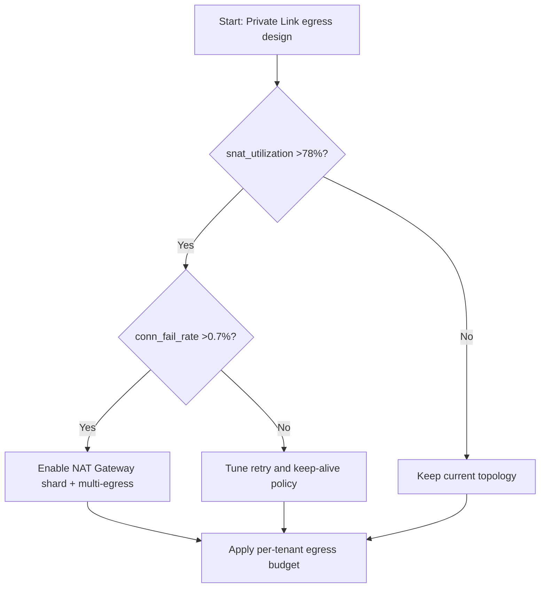
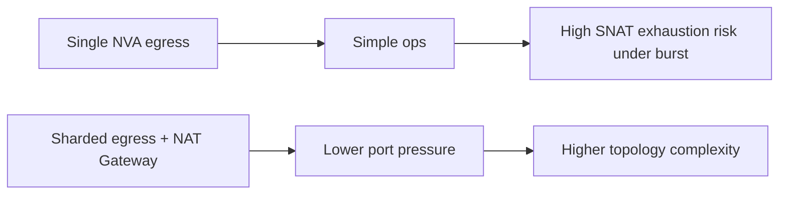
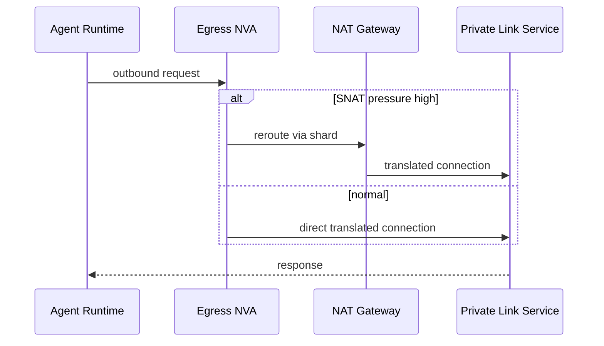

# Agent Private Link + VNet NVA SNAT Port Exhaustion Guard 选型 FAQ（Azure AI Agent Infra）

## 1) 3 分钟结论
- **当 NVA 出向 SNAT 端口利用率持续 >78% 且连接失败率 >0.7% 时，必须启用“多出口分片 + NAT Gateway 分流”**，不能继续单出口硬扛。
- **Private Link 大并发场景下，优先减少短连接抖动（连接池复用、长连接保活）再扩容带宽**；否则只会放大端口耗尽。
- **生产分界线：每实例可用 SNAT 端口预算 <15k 且峰值新建连接速率 >2.8k/s 时，必须做端口预算治理。**

## 2) Q1 / Q2 / Q3
- **为什么会“看起来带宽够但还超时”？**：瓶颈是 SNAT 端口，不是链路吞吐。
- **为什么 Private Link 更容易触发？**：东西向服务调用密集、连接寿命短、重试放大。
- **最小改造闭环？**：端口预算模型、连接复用策略、分流拓扑、失败熔断。

### Q1：何时必须加 NAT Gateway 分流？
`snat_utilization > 78%` 且 `conn_fail_rate > 0.7%` 连续两个窗口（5 分钟）触发。

### Q2：何时先做应用改造？
当 `new_conn_rate` 主要来自短连接抖动，先改连接池与重试退避。

### Q3：如何量化改造收益？
比较单位时间失败连接下降率与新增网络成本的 ROI。

## 3) Mermaid 图
### 3.1 决策树

### 3.2 路径对比

### 3.3 时序

## 4) 决策矩阵
| 维度 | 单 NVA 出口 | 分片出口 + NAT Gateway（推荐） |
|---|---:|---:|
| 连接失败率 | 0.6%–2.4% | 0.1%–0.6% |
| P95 建连时延 | 180–420ms | 95–210ms |
| SNAT 端口利用率峰值 | 75%–96% | 42%–71% |
| 运维复杂度（1-10） | 5 | 8 |
| 成本 | 低到中 | 中 |
| 可扩展性 | 中 | 高 |

## 5) 定量算例与 7-Card 洞察
- 端口压力：`PortPressure = ActiveConnections / SNATPortBudget`
- 失败成本：`FailCost = FailedConnections * RetryCostPerConn`
- 示例（`synthetic_assumed`）：
  - `ActiveConnections=46,000, SNATPortBudget=54,000`
  - `PortPressure=85.2%`
  - `FailedConnections=1,280/h, RetryCostPerConn=$0.00031`
  - `FailCost=$0.3968/h`
- 证据：
  - `workshops/azure-agent-infra/evidence/cycle-1452-benchmark.json`
  - `workshops/azure-agent-infra/evidence/cycle-1452-sources.json`
- 标签：`official/synthetic_assumed/not_measured`。

## 6) 生产核验 Checklist
- [ ] 已建立 SNAT 端口预算与告警阈值
- [ ] 应用连接池、重试退避、超时策略已统一
- [ ] 分片出口与租户路由策略可灰度开关
- [ ] 故障演练覆盖端口耗尽与自动分流回退
- [ ] FAQ/7-Card 来源与时间戳完整
