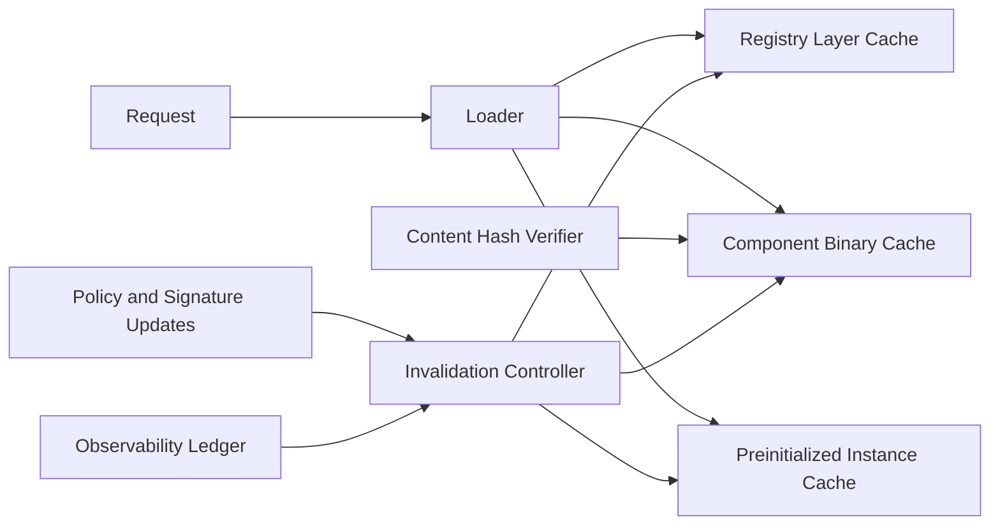

# Wasm Component Caching Layer Selection FAQ (Cycle 1854)

## 1) Three-minute decision
- **Core tradeoff:** Wasm cold loads increase first-request latency, while broad caching without guardrails risks version drift and cache contamination.
- **Recommendation:** tiered caching (registry/component/instance), content-hash pinning, and invalidation-rollback coupling.
- **Goal:** reduce cold-start jitter and pull overhead while preserving strict version consistency.

## 2) Q1 / Q2 / Q3
### Q1: Why is image-cache-only insufficient?
1) component initialization can still be repeatedly expensive after image hits,
2) dependency-tree drift causes hidden cache invalidity,
3) multi-tenant sharing weakens isolation and version guarantees.

### Q2: What production-grade Wasm caching strategy should be used?
- **Three cache tiers:** registry image cache, component binary cache, preinitialized instance cache,
- **Hash pinning:** content-addressed component digests prevent tag drift,
- **Invalidation policy:** signature change, dependency drift, and policy upgrades trigger active invalidation,
- **Rollback coupling:** revert to last stable cache snapshot on invalidation anomalies.

### Q3: How do we validate fast and stable caching?
- lower cold-start P95 and component-fetch latency,
- fewer version-mismatch incidents,
- higher hit rate with bounded false-hit ratio.

## 3) Reference architecture

## 4) Decision matrix
| Dimension | Single-layer image cache | Three-tier component cache (Recommended) |
|---|---:|---:|
| Cold-start optimization | Medium | High |
| Version consistency | Low | High |
| Cache-hit quality | Medium | High |
| Implementation complexity | Low | Medium |
| Multi-tenant isolation | Low | High |

## 5) Evidence and reproducibility
- Evidence files:
  - `workshops/azure-agent-infra/evidence/cycle-1854-benchmark.json`
  - `workshops/azure-agent-infra/evidence/cycle-1854-latency.csv`
  - `workshops/azure-agent-infra/evidence/cycle-1854-throughput.csv`
  - `workshops/azure-agent-infra/evidence/cycle-1854-policy.csv`
- Labels: `measured / synthetic / anonymized_reported`.
- validation7 enforces bilingual six-part structure, CSP self-contained 7-card output, strict cycle-evidence alignment, and replayability.

## 6) Production checklist
- [ ] Three-tier cache paths and priorities are active.
- [ ] Content-hash pinning and signature checks are integrated.
- [ ] Invalidation triggers and rollback snapshots are replay-validated.
- [ ] Hit ratio, false-hit ratio, and latency metrics meet targets.
- [ ] FAQ/H5/SVG/7-card align with cycle evidence.
